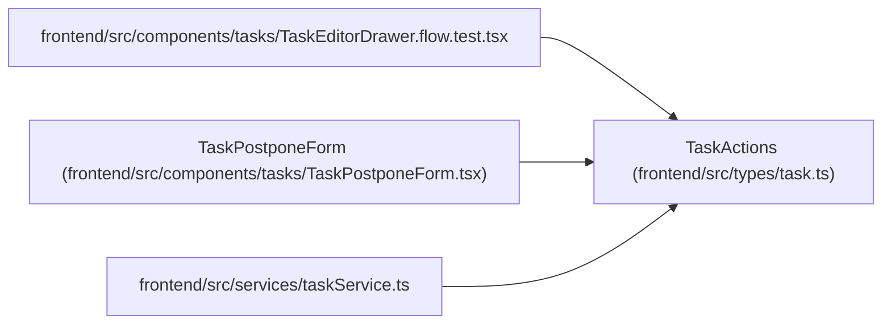

# TaskActions

**Location:** `frontend/src/types/task.ts:512`
**Kind:** Interface
**Bases:** —
**Module:** [types_task](../modules/types_task.md)

## Description

_Auto-generated from `TaskActions` in `frontend/src/types/task.ts`._

## Attributes

| Name | Type | Required | Default | Description |
|------|------|----------|---------|-------------|
| `task_id` | `number` | Yes | — | — |
| `version` | `number` | Yes | — | — |
| `actions` | `TaskActionAvailability[]` | Yes | — | — |
| `claim_generation` | `number` | Yes | — | — |
| `running_run_ids` | `number[]` | Yes | — | — |
| `live_assignment_ids` | `number[]` | Yes | — | — |

## Methods

*No declared methods.*

## Relationships

<!-- Auto-generated relationship summary. Do not edit by hand. -->

### Summary

| Module | Methods | Attributes |
|---|---:|---|
| [types_task](../modules/types_task.md) | 0 | `actions`, `claim_generation`, `live_assignment_ids`, `running_run_ids`, `task_id`, `version` |

### References

| Reference | Kind | Source | Call sites |
|---|---|---|---:|
| `TaskEditorDrawer.flow.test` | import | [TaskEditorDrawer.flow.test](../modules/TaskEditorDrawer.flow.test.md) | — |
| `TaskPostponeForm` | type_reference | [TaskPostponeForm](../modules/TaskPostponeForm.md) | — |
| `taskService` | import | [taskService](../modules/taskService.md) | — |
