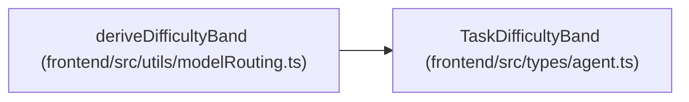

# TaskDifficultyBand

**Location:** `frontend/src/types/agent.ts:21`
**Kind:** Type alias
**Bases:** —
**Module:** [types_agent](../modules/types_agent.md)
**Target:**

```typescript
'routine' | 'standard' | 'advanced'
```

## Description

_Auto-generated from `TaskDifficultyBand` in `frontend/src/types/agent.ts`._

## Attributes

*See the alias definition for its member types.*

## Methods

*See the alias definition for callable and member types.*

## Relationships

<!-- Auto-generated relationship summary. Do not edit by hand. -->


### Summary

| Module | Methods | Attributes |
|---|---:|---|
| [types_agent](../modules/types_agent.md) | 0 | — |

### References

| Reference | Kind | Source | Call sites |
|---|---|---|---:|
| `deriveDifficultyBand` | type_reference | [modelRouting](../modules/modelRouting.md) | — |
