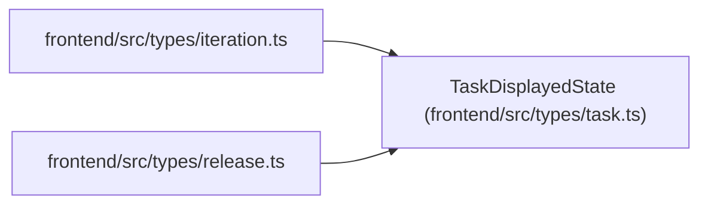

# TaskDisplayedState

**Location:** `frontend/src/types/task.ts:55`
**Kind:** Type alias
**Bases:** —
**Module:** [types_task](../modules/types_task.md)
**Target:**

```typescript
TaskStatus | TaskTerminalState
```

## Description

What a task is shown as: its stored status, or its terminal state.

## Attributes

*See the alias definition for its member types.*

## Methods

*See the alias definition for callable and member types.*

## Relationships

<!-- Auto-generated relationship summary. Do not edit by hand. -->


### Summary

| Module | Methods | Attributes |
|---|---:|---|
| [types_task](../modules/types_task.md) | 0 | — |

### References

| Reference | Kind | Source | Call sites |
|---|---|---|---:|
| `iteration` | import | [types_iteration](../modules/types_iteration.md) | — |
| `release` | import | [types_release](../modules/types_release.md) | — |
