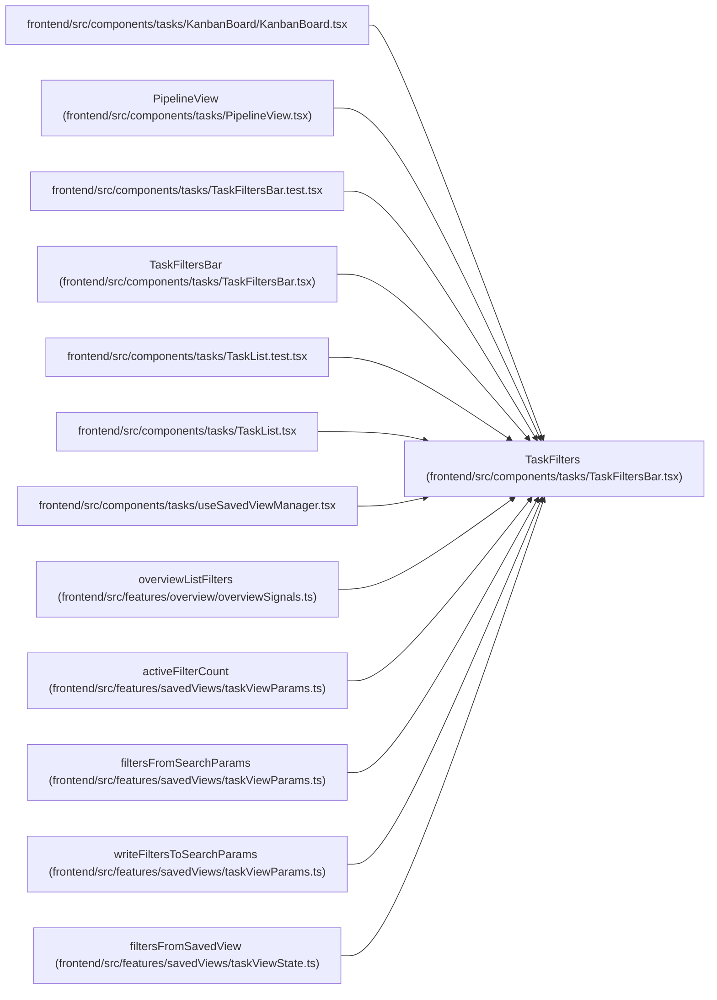

# TaskFilters

**Location:** `frontend/src/components/tasks/TaskFiltersBar.tsx:14`
**Kind:** Interface
**Bases:** —
**Module:** [TaskFiltersBar](../modules/TaskFiltersBar.md)

## Description

_Auto-generated from `TaskFilters` in `frontend/src/components/tasks/TaskFiltersBar.tsx`._

## Attributes

| Name | Type | Required | Default | Description |
|------|------|----------|---------|-------------|
| `planningIssue` | `PlanningTaskIssue \| null` | Yes | — | — |
| `assigneeId` | `number \| null` | Yes | — | — |
| `projectId` | `number \| null` | Yes | — | — |
| `milestoneId` | `number \| null` | Yes | — | — |
| `needsAttention` | `boolean \| null` | Yes | — | — |
| `priority` | `number \| null` | Yes | — | — |
| `status` | `string \| null` | Yes | — | — |
| `hasDependency` | `boolean \| null` | Yes | — | — |
| `isOverdue` | `boolean \| null` | Yes | — | — |
| `isIterationOverflow` | `boolean \| null` | No | — | — |
| `isBlocked` | `boolean \| null` | No | — | — |
| `agentReady` | `boolean \| null` | Yes | — | — |
| `startDateFrom` | `string` | Yes | — | — |
| `startDateTo` | `string` | Yes | — | — |
| `endDateFrom` | `string` | Yes | — | — |
| `endDateTo` | `string` | Yes | — | — |
| `labelSlugs` | `string[]` | Yes | — | — |
| `labelGroupKeys` | `string[]` | Yes | — | — |

## Methods

*No declared methods.*

## Relationships

<!-- Auto-generated relationship summary. Do not edit by hand. -->

### Summary

| Module | Methods | Attributes |
|---|---:|---|
| [TaskFiltersBar](../modules/TaskFiltersBar.md) | 0 | `agentReady`, `assigneeId`, `endDateFrom`, `endDateTo`, `hasDependency`, `isBlocked`, `isIterationOverflow`, `isOverdue`, `labelGroupKeys`, `labelSlugs`, `milestoneId`, `needsAttention` |

### References

| Reference | Kind | Source | Call sites |
|---|---|---|---:|
| `KanbanBoard` | import | [KanbanBoard](../modules/KanbanBoard.md) | — |
| `PipelineView` | type_reference | [PipelineView](../modules/PipelineView.md) | — |
| `TaskFiltersBar.test` | import | [TaskFiltersBar.test](../modules/TaskFiltersBar.test.md) | — |
| `TaskFiltersBar` | type_reference | [TaskFiltersBar](../modules/TaskFiltersBar.md) | — |
| `TaskList.test` | import | [TaskList.test](../modules/TaskList.test.md) | — |
| `TaskList` | import | [TaskList](../modules/TaskList.md) | — |
| `useSavedViewManager` | import | [useSavedViewManager](../modules/useSavedViewManager.md) | — |
| `overviewListFilters` | type_reference | [overviewSignals](../modules/overviewSignals.md) | — |
| `activeFilterCount` | type_reference | [taskViewParams](../modules/taskViewParams.md) | — |
| `filtersFromSearchParams` | type_reference | [taskViewParams](../modules/taskViewParams.md) | — |
| `writeFiltersToSearchParams` | type_reference | [taskViewParams](../modules/taskViewParams.md) | — |
| `filtersFromSavedView` | type_reference | [taskViewState](../modules/taskViewState.md) | — |

> References: showing 12 of 20 logical references; 8 omitted by the 12-row generated summary limit.
