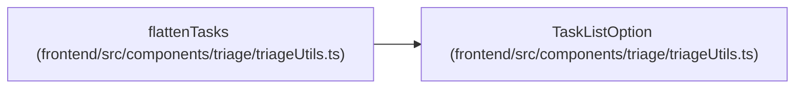

# TaskListOption

**Location:** `frontend/src/components/triage/triageUtils.ts:112`
**Kind:** Interface
**Bases:** —
**Module:** [triageUtils](../modules/triageUtils.md)

## Description

_Auto-generated from `TaskListOption` in `frontend/src/components/triage/triageUtils.ts`._

## Attributes

| Name | Type | Required | Default | Description |
|------|------|----------|---------|-------------|
| `id` | `number` | Yes | — | — |
| `title` | `string` | Yes | — | — |
| `depth` | `number` | Yes | — | — |

## Methods

*No declared methods.*

## Relationships

<!-- Auto-generated relationship summary. Do not edit by hand. -->

### Summary

| Module | Methods | Attributes |
|---|---:|---|
| [triageUtils](../modules/triageUtils.md) | 0 | `depth`, `id`, `title` |

### References

| Reference | Kind | Source | Call sites |
|---|---|---|---:|
| `flattenTasks` | type_reference | [triageUtils](../modules/triageUtils.md) | — |
