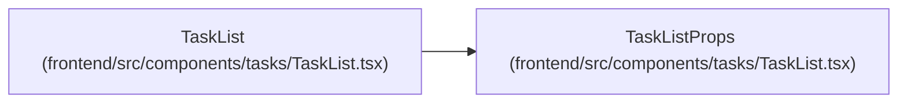

# TaskListProps

**Location:** `frontend/src/components/tasks/TaskList.tsx:71`
**Kind:** Interface
**Bases:** —
**Module:** [TaskList](../modules/TaskList.md)

## Description

_Auto-generated from `TaskListProps` in `frontend/src/components/tasks/TaskList.tsx`._

## Attributes

| Name | Type | Required | Default | Description |
|------|------|----------|---------|-------------|
| `iterationId` | `number` | Yes | — | — |
| `filters` | `TaskFilters` | No | — | — |
| `sortKey` | `SortKey` | Yes | — | — |
| `onSortKeyChange` | `(sortKey: SortKey) => void` | Yes | — | — |
| `hasActiveFilters` | `boolean` | No | — | — |
| `activeViewName` | `string` | No | — | — |
| `onClearFilters` | `() => void` | No | — | — |
| `onCreateTask` | `() => void` | No | — | — |
| `requestedMode` | `TaskMode \| null` | No | — | — |
| `onModeChange` | `(mode: TaskMode \| null) => void` | No | — | — |
| `preselectAllInBulk` | `boolean` | No | — | — |
| `onOpenTask` | `(task: Task) => void` | No | — | — |

## Methods

*No declared methods.*

## Relationships

<!-- Auto-generated relationship summary. Do not edit by hand. -->

### Summary

| Module | Methods | Attributes |
|---|---:|---|
| [TaskList](../modules/TaskList.md) | 0 | `activeViewName`, `filters`, `hasActiveFilters`, `iterationId`, `onClearFilters`, `onCreateTask`, `onModeChange`, `onOpenTask`, `onSortKeyChange`, `preselectAllInBulk`, `requestedMode`, `sortKey` |

### References

| Reference | Kind | Source | Call sites |
|---|---|---|---:|
| `TaskList` | type_reference | [TaskList](../modules/TaskList.md) | — |
