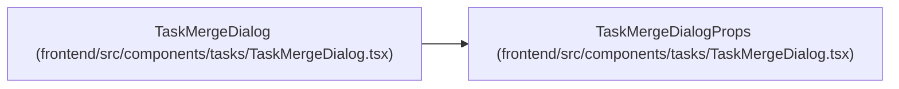

# TaskMergeDialogProps

**Location:** `frontend/src/components/tasks/TaskMergeDialog.tsx:12`
**Kind:** Interface
**Bases:** —
**Module:** [TaskMergeDialog](../modules/TaskMergeDialog.md)

## Description

_Auto-generated from `TaskMergeDialogProps` in `frontend/src/components/tasks/TaskMergeDialog.tsx`._

## Attributes

| Name | Type | Required | Default | Description |
|------|------|----------|---------|-------------|
| `iterationId` | `number` | Yes | — | — |
| `taskIds` | `number[]` | Yes | — | — |
| `onClose` | `() => void` | Yes | — | — |
| `onMerged` | `() => void` | Yes | — | — |

## Methods

*No declared methods.*

## Relationships

<!-- Auto-generated relationship summary. Do not edit by hand. -->

### Summary

| Module | Methods | Attributes |
|---|---:|---|
| [TaskMergeDialog](../modules/TaskMergeDialog.md) | 0 | `iterationId`, `onClose`, `onMerged`, `taskIds` |

### References

| Reference | Kind | Source | Call sites |
|---|---|---|---:|
| `TaskMergeDialog` | type_reference | [TaskMergeDialog](../modules/TaskMergeDialog.md) | — |
