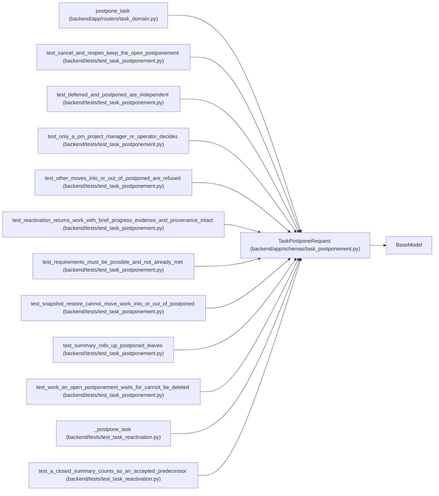

# TaskPostponeRequest

**Location:** `backend/app/schemas/task_postponement.py:60`
**Kind:** Pydantic model
**Bases:** `BaseModel`
**Module:** [schemas_task_postponement](../modules/schemas_task_postponement.md)

## Description

Stop planned, active or resolved work until its reactivation requirements are met.

Postponing work with a live claim, assignment or run releases them. Supply the
current claim generation, running run IDs and live assignment IDs from
``GET /api/tasks/{task_id}/actions``, as for cancellation.

## Model Configuration

| Setting | Value | Source |
|---------|-------|--------|
| `extra` | `'forbid'` | model_config |

## Validators

| Method | Scope | Fields | Mode | Options |
|--------|-------|--------|------|---------|
| `_reason` | field | reason | after | — |

## Attributes

| Name | Type | Wire name | Required | Nullable | Default | Constraints | Examples | Description |
|------|------|-----------|----------|----------|---------|-------------|-------------|----------|
| `expected_version` | `int` | `expected_version` | Yes | No | — | ge=1 | — | — |
| `reason` | `str` | `reason` | Yes | No | — | max_length=2000; min_length=1 | — | — |
| `requirements` | `list[ReactivationRequirementInput]` | `requirements` | Yes | No | — | min_length=1; max_length=unknown (MAX_REACTIVATION_REQUIREMENTS) | — | — |
| `expected_claim_generation` | `int \| None` | `expected_claim_generation` | No | Yes | `None` | ge=0 | — | — |
| `expected_running_run_ids` | `list[int]` | `expected_running_run_ids` | No | No | factory: `list` | max_length=100 | — | — |
| `expected_live_assignment_ids` | `list[int]` | `expected_live_assignment_ids` | No | No | factory: `list` | max_length=100 | — | — |

## Methods

| Method | Signature | Decorators | Description |
|--------|-----------|------------|-------------|
| `_reason` | `(value: str) -> str` | `@field_validator('reason')`, `@classmethod` | — |

## Relationships

<!-- Auto-generated relationship summary. Do not edit by hand. -->

### Summary

| Module | Methods | Attributes |
|---|---:|---|
| [schemas_task_postponement](../modules/schemas_task_postponement.md) | 1 | `expected_claim_generation`, `expected_live_assignment_ids`, `expected_running_run_ids`, `expected_version`, `reason`, `requirements` |

### Structure

| Kind | Entity | Module |
|---|---|---|
| Base | `BaseModel` | — |

### References

| Reference | Kind | Source | Call sites |
|---|---|---|---:|
| `postpone_task` | type_reference | [routers_task_domain](../modules/routers_task_domain.md) | — |
| `test_cancel_and_reopen_keep_the_open_postponement` | call | [test_task_postponement](../modules/test_task_postponement.md) | 1 |
| `test_deferred_and_postponed_are_independent` | call | [test_task_postponement](../modules/test_task_postponement.md) | 1 |
| `test_only_a_pm_project_manager_or_operator_decides` | call | [test_task_postponement](../modules/test_task_postponement.md) | 4 |
| `test_other_moves_into_or_out_of_postponed_are_refused` | call | [test_task_postponement](../modules/test_task_postponement.md) | 1 |
| `test_reactivation_returns_work_with_brief_progress_evidence_and_provenance_intact` | call | [test_task_postponement](../modules/test_task_postponement.md) | 1 |
| `test_requirements_must_be_possible_and_not_already_met` | call | [test_task_postponement](../modules/test_task_postponement.md) | 2 |
| `test_snapshot_restore_cannot_move_work_into_or_out_of_postponed` | call | [test_task_postponement](../modules/test_task_postponement.md) | 1 |
| `test_summary_rolls_up_postponed_leaves` | call | [test_task_postponement](../modules/test_task_postponement.md) | 1 |
| `test_work_an_open_postponement_waits_for_cannot_be_deleted` | call | [test_task_postponement](../modules/test_task_postponement.md) | 2 |
| `_postpone_task` | call | [test_task_reactivation](../modules/test_task_reactivation.md) | 1 |
| `test_a_closed_summary_counts_as_an_accepted_predecessor` | call | [test_task_reactivation](../modules/test_task_reactivation.md) | 1 |
