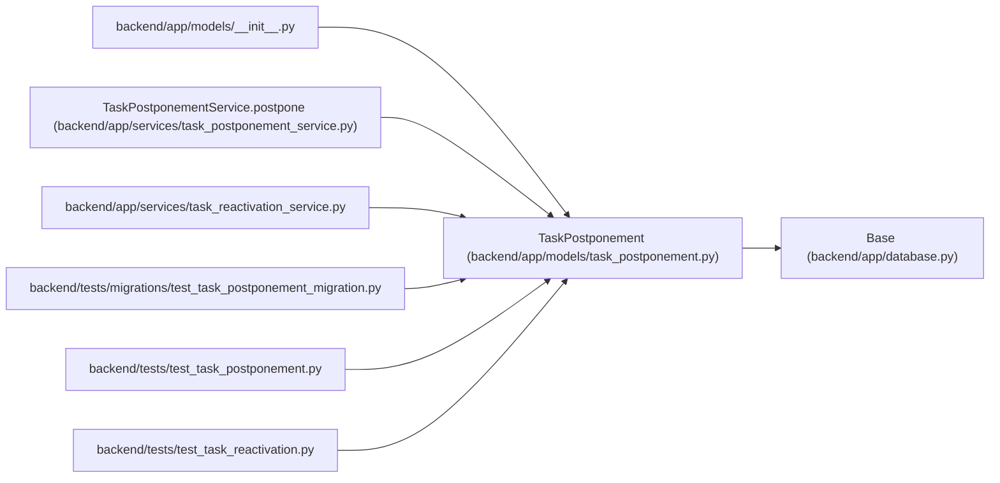

# TaskPostponement

**Location:** `backend/app/models/task_postponement.py:18`
**Kind:** Class
**Bases:** `Base`
**Module:** [models_task_postponement](../modules/models_task_postponement.md)

## Description

One postponement of one task, kept after reactivation as its history.

A task has at most one open postponement: the row whose ``reactivated_at``
is null. ``from_status`` decides where reactivation returns the task:
resolved work returns to resolved, planned and active work to planned.
``released`` lists the claim, assignments and runs the postponement ended.

## Attributes

| Name | Type | Default | Description |
|------|------|---------|-------------|
| `id` | `Mapped[int]` | `mapped_column(Integer, primary_key=True, autoincrement=True)` | — |
| `task_id` | `Mapped[int]` | `mapped_column(ForeignKey('tasks.id', ondelete='CASCADE'), nullable=False)` | — |
| `from_status` | `Mapped[str]` | `mapped_column(String(16), nullable=False)` | — |
| `reason` | `Mapped[str]` | `mapped_column(Text, nullable=False)` | — |
| `postponed_at` | `Mapped[datetime]` | `mapped_column(UTCDateTime(), default=utc_now, nullable=False)` | — |
| `postponed_by_principal_id` | `Mapped[int \| None]` | `mapped_column(ForeignKey('principals.id', ondelete='SET NULL'))` | — |
| `postponed_by_actor_id` | `Mapped[int \| None]` | `mapped_column(ForeignKey('agent_actors.id', ondelete='SET NULL'))` | — |
| `task_version` | `Mapped[int]` | `mapped_column(Integer, nullable=False)` | — |
| `released` | `Mapped[dict]` | `mapped_column(JSON, nullable=False, default=dict)` | — |
| `reactivated_at` | `Mapped[datetime \| None]` | `mapped_column(UTCDateTime())` | — |
| `reactivated_to_status` | `Mapped[str \| None]` | `mapped_column(String(16))` | — |
| `reactivation_trigger` | `Mapped[str \| None]` | `mapped_column(String(32))` | — |
| `reactivation_reason` | `Mapped[str \| None]` | `mapped_column(Text)` | — |
| `reactivated_by_principal_id` | `Mapped[int \| None]` | `mapped_column(ForeignKey('principals.id', ondelete='SET NULL'))` | — |
| `reactivated_by_actor_id` | `Mapped[int \| None]` | `mapped_column(ForeignKey('agent_actors.id', ondelete='SET NULL'))` | — |

## Methods

*No declared methods.*

## Relationships

<!-- Auto-generated relationship summary. Do not edit by hand. -->

### Summary

| Module | Methods | Attributes |
|---|---:|---|
| [models_task_postponement](../modules/models_task_postponement.md) | 0 | `from_status`, `id`, `postponed_at`, `postponed_by_actor_id`, `postponed_by_principal_id`, `reactivated_at`, `reactivated_by_actor_id`, `reactivated_by_principal_id`, `reactivated_to_status`, `reactivation_reason`, `reactivation_trigger`, `reason` |

### Structure

| Kind | Entity | Module |
|---|---|---|
| Base | `Base` | [app_database](../modules/app_database.md) |

### References

| Reference | Kind | Source | Call sites |
|---|---|---|---:|
| `__init__` | import | [models___init__](../modules/models___init__.md) | — |
| `TaskPostponementService.postpone` | call | [task_postponement_service](../modules/task_postponement_service.md) | 1 |
| `task_reactivation_service` | import | [task_reactivation_service](../modules/task_reactivation_service.md) | — |
| `test_task_postponement_migration` | import | [test_task_postponement_migration](../modules/test_task_postponement_migration.md) | — |
| `test_task_postponement` | import | [test_task_postponement](../modules/test_task_postponement.md) | — |
| `test_task_reactivation` | import | [test_task_reactivation](../modules/test_task_reactivation.md) | — |
