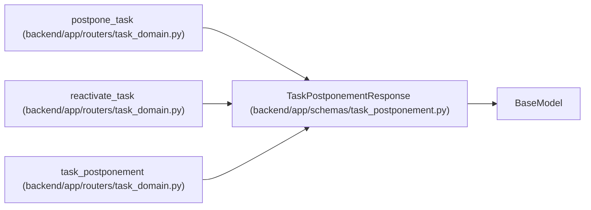

# TaskPostponementResponse

**Location:** `backend/app/schemas/task_postponement.py:137`
**Kind:** Pydantic model
**Bases:** `BaseModel`
**Module:** [schemas_task_postponement](../modules/schemas_task_postponement.md)

## Description

_Auto-generated from `TaskPostponementResponse` in `backend/app/schemas/task_postponement.py`._

## Attributes

| Name | Type | Wire name | Required | Nullable | Default | Constraints | Examples | Description |
|------|------|-----------|----------|----------|---------|-------------|-------------|----------|
| `task` | `TaskResponse` | `task` | Yes | No | — | — | — | — |
| `postponement` | `TaskPostponementRecord \| None` | `postponement` | Yes | Yes | — | — | — | The open or most recent postponement; null only for work reactivated from a postponed state that had no record. |

## Methods

*No declared methods.*

## Relationships

<!-- Auto-generated relationship summary. Do not edit by hand. -->

### Summary

| Module | Methods | Attributes |
|---|---:|---|
| [schemas_task_postponement](../modules/schemas_task_postponement.md) | 0 | `postponement`, `task` |

### Structure

| Kind | Entity | Module |
|---|---|---|
| Base | `BaseModel` | — |

### References

| Reference | Kind | Source | Call sites |
|---|---|---|---:|
| `postpone_task` | type_reference | [routers_task_domain](../modules/routers_task_domain.md) | — |
| `reactivate_task` | type_reference | [routers_task_domain](../modules/routers_task_domain.md) | — |
| `task_postponement` | type_reference | [routers_task_domain](../modules/routers_task_domain.md) | — |
