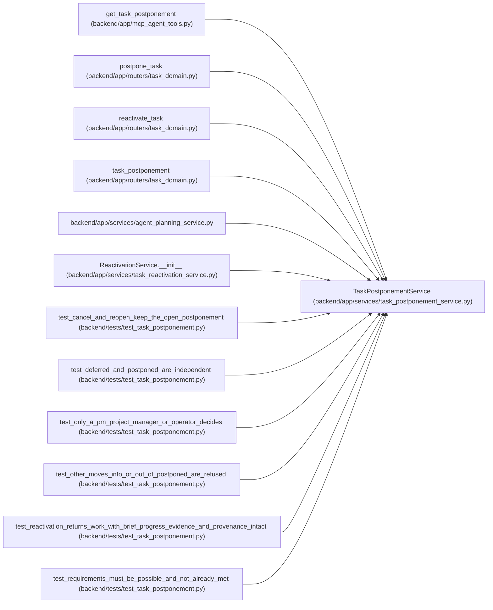

# TaskPostponementService

**Location:** `backend/app/services/task_postponement_service.py:171`
**Kind:** Class
**Bases:** —
**Module:** [task_postponement_service](../modules/task_postponement_service.md)

## Description

Stops planned, active or resolved leaf work without canceling it, and returns it later. Postponing records the reason, who decided and the requirements that must hold, releases live execution through the same fenced path as cancellation, and keeps the brief, progress, evidence and execution provenance intact. Reactivation returns resolved work to resolved and everything else to planned. Only the project's PM actor, a project manager or an operator may decide; automatic reactivation by met requirements is done by the reactivation service. This is distinct from deferral, which is a scheduling policy for backlog work.

## Attributes

*No annotated attributes found.*

## Methods

| Method | Signature | Decorators | Description |
|--------|-----------|------------|-------------|
| `__init__` | `(db)` | — | — |
| `tasks` | `()` | `@property` | — |
| `get` | *(async)* `(task_id)` | — | The task with its open postponement, or its most recent one. |
| `projection` | *(async)* `(task_id, postponement)` | — | The task and its postponement record in the shape clients receive. |
| `_locked_task` | *(async)* `(task_id, expected_version)` | — | Authorize the decider, lock the task's tree scope, check the expected version and refuse summaries, parents and canceled work. |
| `postpone` | *(async)* `(task_id, data, *, commit = True)` | `@atomic_command` | Stop planned, active or resolved leaf work until its requirements are met. |
| `reactivate` | *(async)* `(task_id, data, *, trigger = 'command', commit = True)` | `@atomic_command` | Return postponed work to planned, or to resolved if it was postponed after resolution. |
| `resume` | *(async)* `(task, postponement, *, reason, trigger, expected_version, automatic = False, event_extra = None)` | — | Move locked postponed work back to planned or resolved and close its postponement. |
| `_requirements` | *(async)* `(task, items)` | — | Validate each requirement against current facts; refuse one that can never or already holds. |
| `_timezone` | *(async)* `(task)` | — | The working time zone that date requirements are judged in: the project's, else the iteration calendar's. |

## Relationships

<!-- Auto-generated relationship summary. Do not edit by hand. -->

### Summary

| Module | Methods | Attributes |
|---|---:|---|
| [task_postponement_service](../modules/task_postponement_service.md) | 10 | — |

### References

| Reference | Kind | Source | Call sites |
|---|---|---|---:|
| `get_task_postponement` | call | [mcp_agent_tools](../modules/mcp_agent_tools.md) | 1 |
| `postpone_task` | call | [routers_task_domain](../modules/routers_task_domain.md) | 1 |
| `reactivate_task` | call | [routers_task_domain](../modules/routers_task_domain.md) | 1 |
| `task_postponement` | call | [routers_task_domain](../modules/routers_task_domain.md) | 1 |
| `agent_planning_service` | import | [agent_planning_service](../modules/agent_planning_service.md) | — |
| `ReactivationService.__init__` | call | [task_reactivation_service](../modules/task_reactivation_service.md) | 1 |
| `test_cancel_and_reopen_keep_the_open_postponement` | call | [test_task_postponement](../modules/test_task_postponement.md) | 3 |
| `test_deferred_and_postponed_are_independent` | call | [test_task_postponement](../modules/test_task_postponement.md) | 2 |
| `test_only_a_pm_project_manager_or_operator_decides` | call | [test_task_postponement](../modules/test_task_postponement.md) | 5 |
| `test_other_moves_into_or_out_of_postponed_are_refused` | call | [test_task_postponement](../modules/test_task_postponement.md) | 1 |
| `test_reactivation_returns_work_with_brief_progress_evidence_and_provenance_intact` | call | [test_task_postponement](../modules/test_task_postponement.md) | 1 |
| `test_requirements_must_be_possible_and_not_already_met` | call | [test_task_postponement](../modules/test_task_postponement.md) | 1 |

> References: showing 12 of 18 logical references; 6 omitted by the 12-row generated summary limit.
