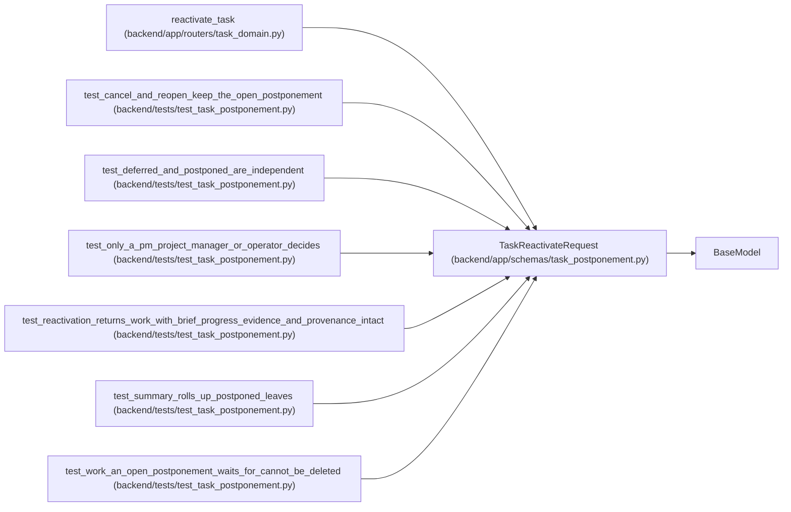

# TaskReactivateRequest

**Location:** `backend/app/schemas/task_postponement.py:83`
**Kind:** Pydantic model
**Bases:** `BaseModel`
**Module:** [schemas_task_postponement](../modules/schemas_task_postponement.md)

## Description

Return postponed work to planned, or to resolved when it was postponed after resolution.

## Model Configuration

| Setting | Value | Source |
|---------|-------|--------|
| `extra` | `'forbid'` | model_config |

## Validators

| Method | Scope | Fields | Mode | Options |
|--------|-------|--------|------|---------|
| `_reason` | field | reason | after | — |

## Attributes

| Name | Type | Wire name | Required | Nullable | Default | Constraints | Examples | Description |
|------|------|-----------|----------|----------|---------|-------------|-------------|----------|
| `expected_version` | `int` | `expected_version` | Yes | No | — | ge=1 | — | — |
| `reason` | `str` | `reason` | Yes | No | — | max_length=2000; min_length=1 | — | — |

## Methods

| Method | Signature | Decorators | Description |
|--------|-----------|------------|-------------|
| `_reason` | `(value: str) -> str` | `@field_validator('reason')`, `@classmethod` | — |

## Relationships

<!-- Auto-generated relationship summary. Do not edit by hand. -->

### Summary

| Module | Methods | Attributes |
|---|---:|---|
| [schemas_task_postponement](../modules/schemas_task_postponement.md) | 1 | `expected_version`, `reason` |

### Structure

| Kind | Entity | Module |
|---|---|---|
| Base | `BaseModel` | — |

### References

| Reference | Kind | Source | Call sites |
|---|---|---|---:|
| `reactivate_task` | type_reference | [routers_task_domain](../modules/routers_task_domain.md) | — |
| `test_cancel_and_reopen_keep_the_open_postponement` | call | [test_task_postponement](../modules/test_task_postponement.md) | 2 |
| `test_deferred_and_postponed_are_independent` | call | [test_task_postponement](../modules/test_task_postponement.md) | 1 |
| `test_only_a_pm_project_manager_or_operator_decides` | call | [test_task_postponement](../modules/test_task_postponement.md) | 1 |
| `test_reactivation_returns_work_with_brief_progress_evidence_and_provenance_intact` | call | [test_task_postponement](../modules/test_task_postponement.md) | 1 |
| `test_summary_rolls_up_postponed_leaves` | call | [test_task_postponement](../modules/test_task_postponement.md) | 1 |
| `test_work_an_open_postponement_waits_for_cannot_be_deleted` | call | [test_task_postponement](../modules/test_task_postponement.md) | 1 |
