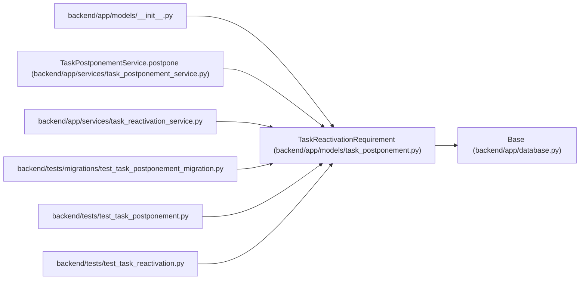

# TaskReactivationRequirement

**Location:** `backend/app/models/task_postponement.py:66`
**Kind:** Class
**Bases:** `Base`
**Module:** [models_task_postponement](../modules/models_task_postponement.md)

## Description

One condition a postponement waits for.

``predecessor_accepted`` names a task that must be accepted, ``date`` a day in
the task's working time zone, ``owner_decision`` a decision the owner records,
and ``linked_resolved`` a task or triage item that must be resolved. Work named
by an open postponement's requirement cannot be deleted; a target of a closed
postponement can, leaving that history row with no target. ``met_at`` stays
null until the requirement is evaluated as met.

## Attributes

| Name | Type | Default | Description |
|------|------|---------|-------------|
| `id` | `Mapped[int]` | `mapped_column(Integer, primary_key=True, autoincrement=True)` | — |
| `postponement_id` | `Mapped[int]` | `mapped_column(ForeignKey('task_postponements.id', ondelete='CASCADE'), nullable=False)` | — |
| `task_id` | `Mapped[int]` | `mapped_column(ForeignKey('tasks.id', ondelete='CASCADE'), nullable=False)` | — |
| `position` | `Mapped[int]` | `mapped_column(Integer, nullable=False)` | — |
| `kind` | `Mapped[str]` | `mapped_column(String(32), nullable=False)` | — |
| `target_task_id` | `Mapped[int \| None]` | `mapped_column(ForeignKey('tasks.id', ondelete='SET NULL'))` | — |
| `target_triage_item_id` | `Mapped[int \| None]` | `mapped_column(ForeignKey('triage_items.id', ondelete='SET NULL'))` | — |
| `on_date` | `Mapped[date \| None]` | `mapped_column(Date)` | — |
| `description` | `Mapped[str \| None]` | `mapped_column(Text)` | — |
| `met_at` | `Mapped[datetime \| None]` | `mapped_column(UTCDateTime())` | — |
| `created_at` | `Mapped[datetime]` | `mapped_column(UTCDateTime(), default=utc_now, nullable=False)` | — |

## Methods

*No declared methods.*

## Relationships

<!-- Auto-generated relationship summary. Do not edit by hand. -->

### Summary

| Module | Methods | Attributes |
|---|---:|---|
| [models_task_postponement](../modules/models_task_postponement.md) | 0 | `created_at`, `description`, `id`, `kind`, `met_at`, `on_date`, `position`, `postponement_id`, `target_task_id`, `target_triage_item_id`, `task_id` |

### Structure

| Kind | Entity | Module |
|---|---|---|
| Base | `Base` | [app_database](../modules/app_database.md) |

### References

| Reference | Kind | Source | Call sites |
|---|---|---|---:|
| `__init__` | import | [models___init__](../modules/models___init__.md) | — |
| `TaskPostponementService.postpone` | call | [task_postponement_service](../modules/task_postponement_service.md) | 1 |
| `task_reactivation_service` | import | [task_reactivation_service](../modules/task_reactivation_service.md) | — |
| `test_task_postponement_migration` | import | [test_task_postponement_migration](../modules/test_task_postponement_migration.md) | — |
| `test_task_postponement` | import | [test_task_postponement](../modules/test_task_postponement.md) | — |
| `test_task_reactivation` | import | [test_task_reactivation](../modules/test_task_reactivation.md) | — |
