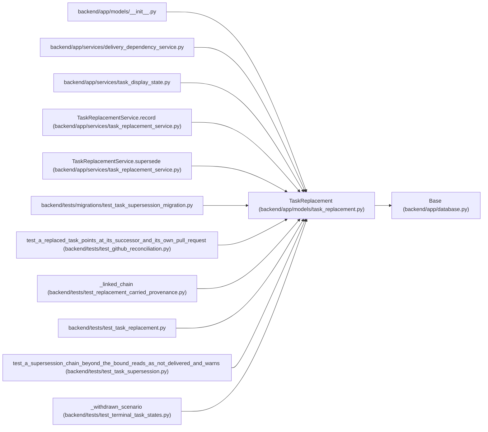

# TaskReplacement

**Location:** `backend/app/models/task_replacement.py:13`
**Kind:** Class
**Bases:** `Base`
**Module:** [models_task_replacement](../modules/models_task_replacement.md)

## Description

Link an original task to the one task that delivers its work instead.

A ``replacement`` disposition names a fresh task that does unattributable work
again from a clean base: only the replacement can be accepted, and only on its
own attributable contributions. A ``supersession`` names work that was already
closed or accepted when the disposition was recorded; it has no base commit and
need not cite an owner decision. Either way the original keeps its attempts,
artifacts and history and is never accepted independently.

## Attributes

| Name | Type | Default | Description |
|------|------|---------|-------------|
| `id` | `Mapped[int]` | `mapped_column(Integer, primary_key=True, autoincrement=True)` | — |
| `project_id` | `Mapped[int]` | `mapped_column(ForeignKey('projects.id', ondelete='CASCADE'), nullable=False)` | — |
| `original_task_id` | `Mapped[int]` | `mapped_column(ForeignKey('tasks.id', ondelete='RESTRICT'), nullable=False)` | — |
| `replacement_task_id` | `Mapped[int]` | `mapped_column(ForeignKey('tasks.id', ondelete='RESTRICT'), nullable=False)` | — |
| `disposition` | `Mapped[str]` | `mapped_column(String(16), nullable=False, default='replacement', server_default='replacement')` | — |
| `reason` | `Mapped[str]` | `mapped_column(Text, nullable=False)` | — |
| `owner_decision` | `Mapped[str \| None]` | `mapped_column(Text)` | — |
| `base_commit_url` | `Mapped[str \| None]` | `mapped_column(String(1000))` | — |
| `carried_run_ids` | `Mapped[list]` | `mapped_column(JSON, nullable=False, default=list)` | — |
| `moved_dependencies` | `Mapped[list]` | `mapped_column(JSON, nullable=False, default=list)` | — |
| `moved_release_ids` | `Mapped[list]` | `mapped_column(JSON, nullable=False, default=list)` | — |
| `original_snapshot` | `Mapped[dict]` | `mapped_column(JSON, nullable=False, default=dict)` | — |
| `review_policy` | `Mapped[dict]` | `mapped_column(JSON, nullable=False, default=dict)` | — |
| `decided_by_principal_id` | `Mapped[int \| None]` | `mapped_column(ForeignKey('principals.id', ondelete='SET NULL'))` | — |
| `decided_by_actor_id` | `Mapped[int \| None]` | `mapped_column(ForeignKey('agent_actors.id', ondelete='SET NULL'))` | — |
| `decided_at` | `Mapped[datetime]` | `mapped_column(UTCDateTime(), default=utc_now, nullable=False)` | — |

## Methods

*No declared methods.*

## Relationships

<!-- Auto-generated relationship summary. Do not edit by hand. -->

### Summary

| Module | Methods | Attributes |
|---|---:|---|
| [models_task_replacement](../modules/models_task_replacement.md) | 0 | `base_commit_url`, `carried_run_ids`, `decided_at`, `decided_by_actor_id`, `decided_by_principal_id`, `disposition`, `id`, `moved_dependencies`, `moved_release_ids`, `original_snapshot`, `original_task_id`, `owner_decision` |

### Structure

| Kind | Entity | Module |
|---|---|---|
| Base | `Base` | [app_database](../modules/app_database.md) |

### References

| Reference | Kind | Source | Call sites |
|---|---|---|---:|
| `__init__` | import | [models___init__](../modules/models___init__.md) | — |
| `delivery_dependency_service` | import | [delivery_dependency_service](../modules/delivery_dependency_service.md) | — |
| `task_display_state` | import | [task_display_state](../modules/task_display_state.md) | — |
| `TaskReplacementService.record` | call | [task_replacement_service](../modules/task_replacement_service.md) | 1 |
| `TaskReplacementService.supersede` | call | [task_replacement_service](../modules/task_replacement_service.md) | 1 |
| `test_task_supersession_migration` | import | [test_task_supersession_migration](../modules/test_task_supersession_migration.md) | — |
| `test_a_replaced_task_points_at_its_successor_and_its_own_pull_request` | call | [test_github_reconciliation](../modules/test_github_reconciliation.md) | 1 |
| `_linked_chain` | call | [test_replacement_carried_provenance](../modules/test_replacement_carried_provenance.md) | 1 |
| `test_task_replacement` | import | [test_task_replacement](../modules/test_task_replacement.md) | — |
| `test_a_supersession_chain_beyond_the_bound_reads_as_not_delivered_and_warns` | call | [test_task_supersession](../modules/test_task_supersession.md) | 1 |
| `_withdrawn_scenario` | call | [test_terminal_task_states](../modules/test_terminal_task_states.md) | 1 |
