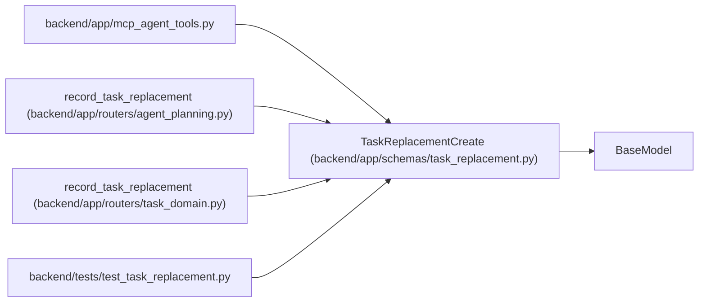

# TaskReplacementCreate

**Location:** `backend/app/schemas/task_replacement.py:9`
**Kind:** Pydantic model
**Bases:** `BaseModel`
**Module:** [schemas_task_replacement](../modules/schemas_task_replacement.md)

## Description

Replace an unaccepted original with a fresh task built from a clean base.

## Model Configuration

| Setting | Value | Source |
|---------|-------|--------|
| `extra` | `'forbid'` | model_config |

## Validators

| Method | Scope | Fields | Mode | Options |
|--------|-------|--------|------|---------|
| `_stripped` | field | reason, owner_decision, base_commit_url | after | — |
| `_distinct` | field | carried_run_ids | after | — |

## Attributes

| Name | Type | Wire name | Required | Nullable | Default | Constraints | Examples | Description |
|------|------|-----------|----------|----------|---------|-------------|-------------|----------|
| `replacement_task_id` | `int` | `replacement_task_id` | Yes | No | — | ge=1 | — | — |
| `expected_original_version` | `int` | `expected_original_version` | Yes | No | — | ge=1 | — | — |
| `expected_replacement_version` | `int` | `expected_replacement_version` | Yes | No | — | ge=1 | — | — |
| `reason` | `str` | `reason` | Yes | No | — | min_length=1; max_length=4000 | — | — |
| `owner_decision` | `str` | `owner_decision` | Yes | No | — | min_length=1; max_length=4000 | — | The owner's recorded decision that authorizes this replacement. |
| `base_commit_url` | `str` | `base_commit_url` | Yes | No | — | min_length=1; max_length=1000 | — | Immutable GitHub commit the replacement is built from. |
| `carried_run_ids` | `list[int]` | `carried_run_ids` | Yes | No | — | max_length=50 | — | Original runs whose commits the replacement carries; empty for a clean rebuild. |

## Methods

| Method | Signature | Decorators | Description |
|--------|-----------|------------|-------------|
| `_stripped` | `(value: str) -> str` | `@field_validator('reason', 'owner_decision', 'base_commit_url')`, `@classmethod` | — |
| `_distinct` | `(value: list[int]) -> list[int]` | `@field_validator('carried_run_ids')`, `@classmethod` | — |

## Relationships

<!-- Auto-generated relationship summary. Do not edit by hand. -->

### Summary

| Module | Methods | Attributes |
|---|---:|---|
| [schemas_task_replacement](../modules/schemas_task_replacement.md) | 2 | `base_commit_url`, `carried_run_ids`, `expected_original_version`, `expected_replacement_version`, `owner_decision`, `reason`, `replacement_task_id` |

### Structure

| Kind | Entity | Module |
|---|---|---|
| Base | `BaseModel` | — |

### References

| Reference | Kind | Source | Call sites |
|---|---|---|---:|
| `mcp_agent_tools` | import | [mcp_agent_tools](../modules/mcp_agent_tools.md) | — |
| `record_task_replacement` | type_reference | [routers_agent_planning](../modules/routers_agent_planning.md) | — |
| `record_task_replacement` | type_reference | [routers_task_domain](../modules/routers_task_domain.md) | — |
| `test_task_replacement` | import | [test_task_replacement](../modules/test_task_replacement.md) | — |
