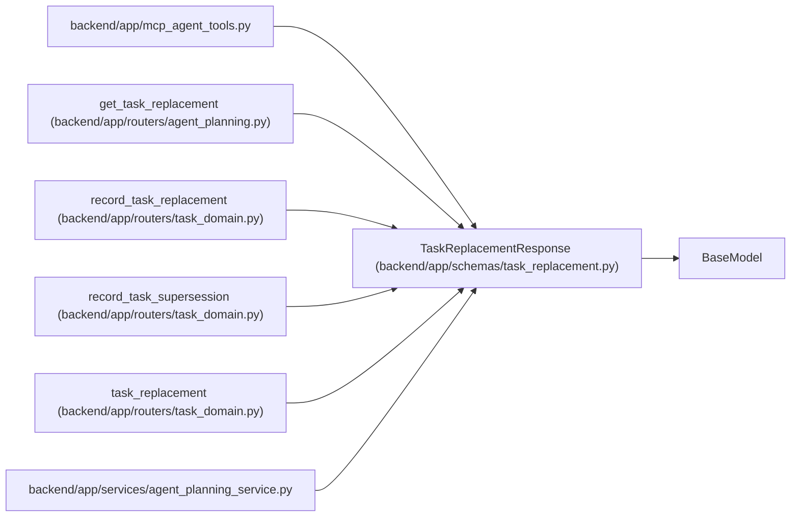

# TaskReplacementResponse

**Location:** `backend/app/schemas/task_replacement.py:129`
**Kind:** Pydantic model
**Bases:** `BaseModel`
**Module:** [schemas_task_replacement](../modules/schemas_task_replacement.md)

## Description

A recorded replacement or supersession as seen from one of its tasks, with its role (original, replacement or successor), the decision, the review policy, both tasks, carried contributions, what moved, and the acceptance state. Acceptance is `clean` or `held`, and a hold names why, such as carried work with no attribution.

## Attributes

| Name | Type | Wire name | Required | Nullable | Default | Constraints | Examples | Description |
|------|------|-----------|----------|----------|---------|-------------|-------------|----------|
| `id` | `int` | `id` | Yes | No | — | — | — | — |
| `project_id` | `int` | `project_id` | Yes | No | — | — | — | — |
| `disposition` | `Literal['replacement', 'supersession']` | `disposition` | Yes | No | — | — | — | — |
| `role` | `Literal['original', 'replacement', 'successor']` | `role` | Yes | No | — | — | — | — |
| `original_task_id` | `int` | `original_task_id` | Yes | No | — | — | — | — |
| `replacement_task_id` | `int` | `replacement_task_id` | Yes | No | — | — | — | — |
| `decision` | `ReplacementDecision` | `decision` | Yes | No | — | — | — | — |
| `review_policy` | `ReplacementReviewPolicy` | `review_policy` | Yes | No | — | — | — | — |
| `original` | `ReplacementOriginal` | `original` | Yes | No | — | — | — | — |
| `replacement` | `ReplacementTask` | `replacement` | Yes | No | — | — | — | — |
| `carried_contributions` | `list[ReplacementContributor]` | `carried_contributions` | Yes | No | — | — | — | — |
| `moved_dependencies` | `list[ReplacementMovedDependency]` | `moved_dependencies` | Yes | No | — | — | — | — |
| `moved_release_ids` | `list[int]` | `moved_release_ids` | Yes | No | — | — | — | — |
| `acceptance` | `ReplacementAcceptance` | `acceptance` | Yes | No | — | — | — | — |

## Methods

*No declared methods.*

## Relationships

<!-- Auto-generated relationship summary. Do not edit by hand. -->

### Summary

| Module | Methods | Attributes |
|---|---:|---|
| [schemas_task_replacement](../modules/schemas_task_replacement.md) | 0 | `acceptance`, `carried_contributions`, `decision`, `disposition`, `id`, `moved_dependencies`, `moved_release_ids`, `original`, `original_task_id`, `project_id`, `replacement`, `replacement_task_id` |

### Structure

| Kind | Entity | Module |
|---|---|---|
| Base | `BaseModel` | — |

### References

| Reference | Kind | Source | Call sites |
|---|---|---|---:|
| `mcp_agent_tools` | import | [mcp_agent_tools](../modules/mcp_agent_tools.md) | — |
| `get_task_replacement` | type_reference | [routers_agent_planning](../modules/routers_agent_planning.md) | — |
| `record_task_replacement` | type_reference | [routers_task_domain](../modules/routers_task_domain.md) | — |
| `record_task_supersession` | type_reference | [routers_task_domain](../modules/routers_task_domain.md) | — |
| `task_replacement` | type_reference | [routers_task_domain](../modules/routers_task_domain.md) | — |
| `agent_planning_service` | import | [agent_planning_service](../modules/agent_planning_service.md) | — |
