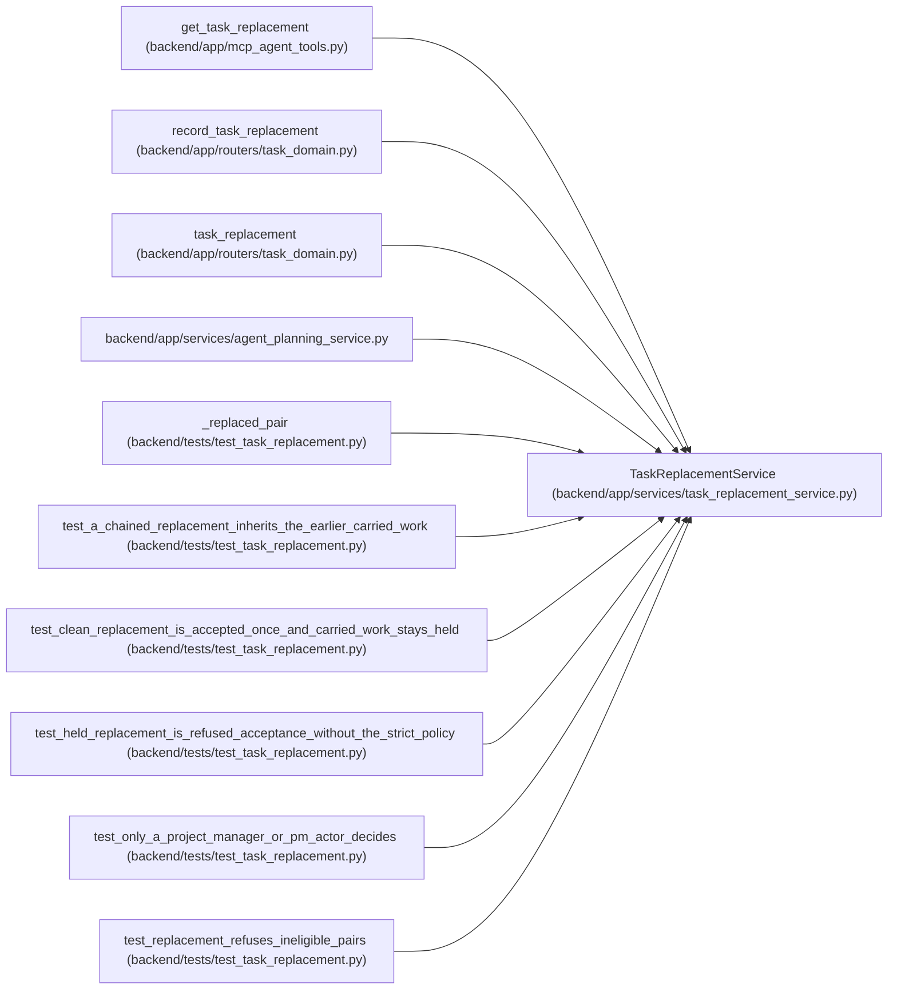

# TaskReplacementService

**Location:** `backend/app/services/task_replacement_service.py:174`
**Kind:** Class
**Bases:** —
**Module:** [task_replacement_service](../modules/task_replacement_service.md)

## Description

_Auto-generated from `TaskReplacementService` in `backend/app/services/task_replacement_service.py`._

## Attributes

*No annotated attributes found.*

## Methods

| Method | Signature | Decorators | Description |
|--------|-----------|------------|-------------|
| `__init__` | `(db)` | — | — |
| `tasks` | `()` | `@property` | — |
| `get` | *(async)* `(task_id)` | — | — |
| `projection` | *(async)* `(relation, task_id)` | — | — |
| `record` | *(async)* `(original_id, data, *, commit = True)` | `@atomic_command` | Link a fresh replacement to an unaccepted original under one audited decision. |
| `_require_eligible` | *(async)* `(original, replacement)` | — | — |
| `_move_dependents` | *(async)* `(original, replacement)` | — | Point each dependent at the replacement; prerequisite identity, not dependent work, changes. |
| `_move_releases` | *(async)* `(original, replacement)` | — | Open releases that planned the original's deliverable count the replacement instead. |

## Relationships

<!-- Auto-generated relationship summary. Do not edit by hand. -->

### Summary

| Module | Methods | Attributes |
|---|---:|---|
| [task_replacement_service](../modules/task_replacement_service.md) | 8 | — |

### References

| Reference | Kind | Source | Call sites |
|---|---|---|---:|
| `get_task_replacement` | call | [mcp_agent_tools](../modules/mcp_agent_tools.md) | 1 |
| `record_task_replacement` | call | [routers_task_domain](../modules/routers_task_domain.md) | 1 |
| `task_replacement` | call | [routers_task_domain](../modules/routers_task_domain.md) | 1 |
| `agent_planning_service` | import | [agent_planning_service](../modules/agent_planning_service.md) | — |
| `_replaced_pair` | call | [test_task_replacement](../modules/test_task_replacement.md) | 1 |
| `test_a_chained_replacement_inherits_the_earlier_carried_work` | call | [test_task_replacement](../modules/test_task_replacement.md) | 1 |
| `test_clean_replacement_is_accepted_once_and_carried_work_stays_held` | call | [test_task_replacement](../modules/test_task_replacement.md) | 2 |
| `test_held_replacement_is_refused_acceptance_without_the_strict_policy` | call | [test_task_replacement](../modules/test_task_replacement.md) | 2 |
| `test_only_a_project_manager_or_pm_actor_decides` | call | [test_task_replacement](../modules/test_task_replacement.md) | 1 |
| `test_replacement_refuses_ineligible_pairs` | call | [test_task_replacement](../modules/test_task_replacement.md) | 1 |
