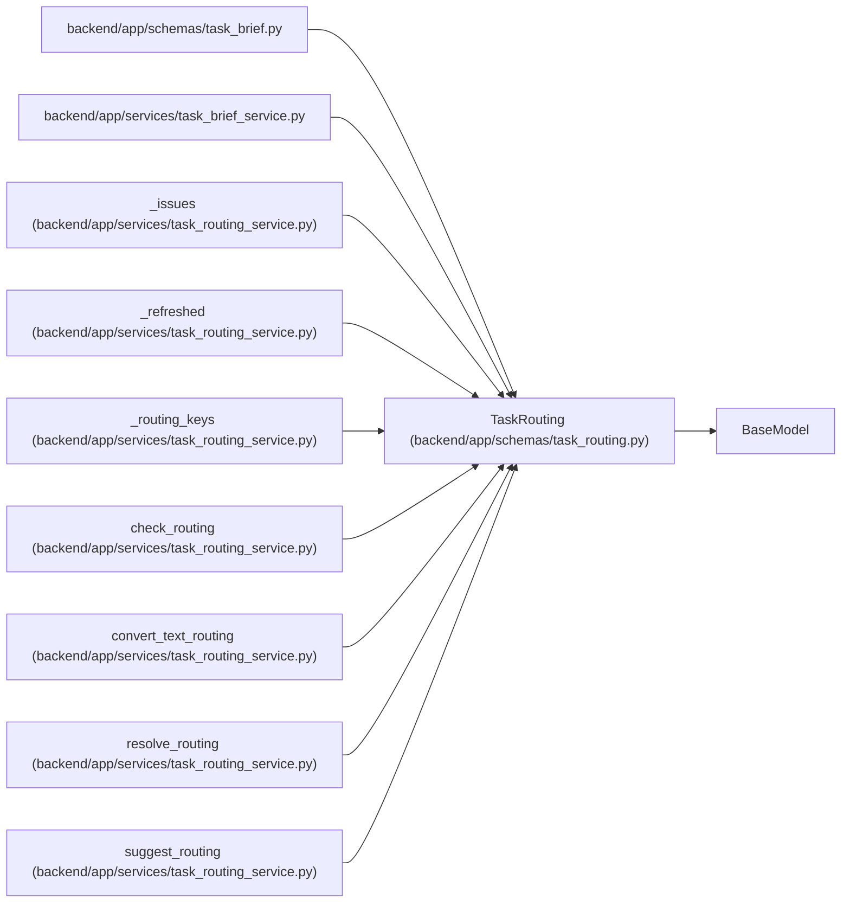

# TaskRouting

**Location:** `backend/app/schemas/task_routing.py:42`
**Kind:** Pydantic model
**Bases:** `BaseModel`
**Module:** [task_routing](../modules/task_routing.md)

## Description

First rung, escalation ladder and reviewer of one task.

## Model Configuration

| Setting | Value | Source |
|---------|-------|--------|
| `extra` | `'forbid'` | model_config |

## Validators

| Method | Scope | Fields | Mode | Options |
|--------|-------|--------|------|---------|
| `bounded_source` | field | source_text | after | — |
| `distinct_rungs` | model | — | after | — |

## Attributes

| Name | Type | Wire name | Required | Nullable | Default | Constraints | Examples | Description |
|------|------|-----------|----------|----------|---------|-------------|-------------|----------|
| `schema_version` | `Literal[1]` | `schema_version` | No | No | `1` | — | — | — |
| `first_rung` | `RoutingRung \| None` | `first_rung` | No | Yes | `None` | — | — | — |
| `escalation` | `list[RoutingRung]` | `escalation` | No | No | factory: `list` | max_length=8 | — | — |
| `escalate_after_failed_runs` | `int` | `escalate_after_failed_runs` | No | No | `2` | ge=1; le=10 | — | — |
| `after_last_rung` | `str` | `after_last_rung` | No | No | `''` | max_length=2000 | — | What happens when the ladder is exhausted. |
| `reviewer` | `RoutingReviewer \| None` | `reviewer` | No | Yes | `None` | — | — | — |
| `notes` | `str` | `notes` | No | No | `''` | max_length=4000 | — | Further routing rules, rendered after the ladder. |
| `source_text` | `list[str]` | `source_text` | No | No | factory: `list` | max_length=20 | — | Original sentences a conversion replaced with this structure; kept for audit and never rendered. |

## Methods

| Method | Signature | Decorators | Description |
|--------|-----------|------------|-------------|
| `bounded_source` | `(value: list[str]) -> list[str]` | `@field_validator('source_text')`, `@classmethod` | — |
| `distinct_rungs` | `()` | `@model_validator(mode='after')` | — |

## Relationships

<!-- Auto-generated relationship summary. Do not edit by hand. -->

### Summary

| Module | Methods | Attributes |
|---|---:|---|
| [task_routing](../modules/task_routing.md) | 2 | `after_last_rung`, `escalate_after_failed_runs`, `escalation`, `first_rung`, `notes`, `reviewer`, `schema_version`, `source_text` |

### Structure

| Kind | Entity | Module |
|---|---|---|
| Base | `BaseModel` | — |

### References

| Reference | Kind | Source | Call sites |
|---|---|---|---:|
| `task_brief` | import | [schemas_task_brief](../modules/schemas_task_brief.md) | — |
| `task_brief_service` | import | [task_brief_service](../modules/task_brief_service.md) | — |
| `_issues` | type_reference | [task_routing_service](../modules/task_routing_service.md) | — |
| `_refreshed` | type_reference | [task_routing_service](../modules/task_routing_service.md) | — |
| `_routing_keys` | type_reference | [task_routing_service](../modules/task_routing_service.md) | — |
| `check_routing` | type_reference | [task_routing_service](../modules/task_routing_service.md) | — |
| `convert_text_routing` | type_reference | [task_routing_service](../modules/task_routing_service.md) | — |
| `resolve_routing` | type_reference | [task_routing_service](../modules/task_routing_service.md) | — |
| `suggest_routing` | type_reference | [task_routing_service](../modules/task_routing_service.md) | — |
