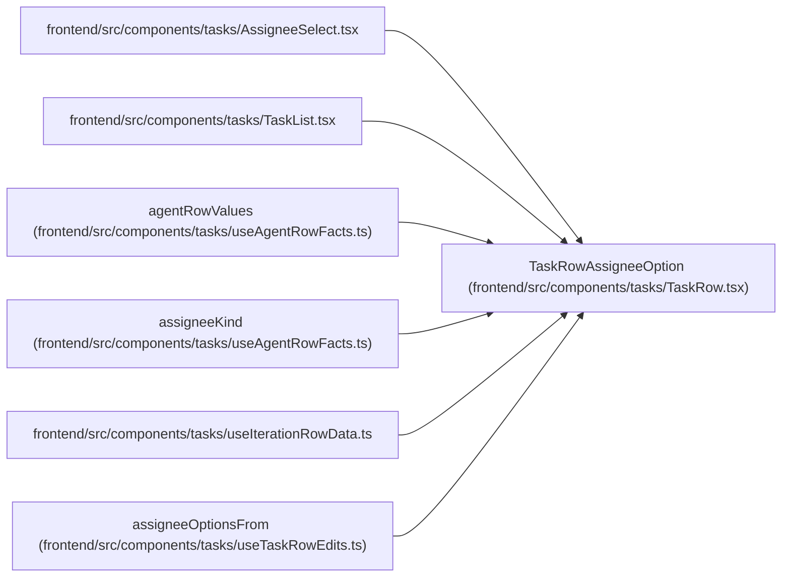

# TaskRowAssigneeOption

**Location:** `frontend/src/components/tasks/TaskRow.tsx:18`
**Kind:** Interface
**Bases:** —
**Module:** [TaskRow](../modules/TaskRow.md)

## Description

_Auto-generated from `TaskRowAssigneeOption` in `frontend/src/components/tasks/TaskRow.tsx`._

## Attributes

| Name | Type | Required | Default | Description |
|------|------|----------|---------|-------------|
| `id` | `number` | Yes | — | — |
| `name` | `string` | Yes | — | — |
| `kind` | `'human' \| 'agent' \| 'hybrid'` | No | — | — |
| `profileId` | `number \| null` | No | — | — |
| `agentConnected` | `boolean` | No | — | — |

## Methods

*No declared methods.*

## Relationships

<!-- Auto-generated relationship summary. Do not edit by hand. -->

### Summary

| Module | Methods | Attributes |
|---|---:|---|
| [TaskRow](../modules/TaskRow.md) | 0 | `agentConnected`, `id`, `kind`, `name`, `profileId` |

### References

| Reference | Kind | Source | Call sites |
|---|---|---|---:|
| `AssigneeSelect` | import | [AssigneeSelect](../modules/AssigneeSelect.md) | — |
| `TaskList` | import | [TaskList](../modules/TaskList.md) | — |
| `agentRowValues` | type_reference | [useAgentRowFacts](../modules/useAgentRowFacts.md) | — |
| `assigneeKind` | type_reference | [useAgentRowFacts](../modules/useAgentRowFacts.md) | — |
| `useIterationRowData` | import | [useIterationRowData](../modules/useIterationRowData.md) | — |
| `assigneeOptionsFrom` | type_reference | [useTaskRowEdits](../modules/useTaskRowEdits.md) | — |
