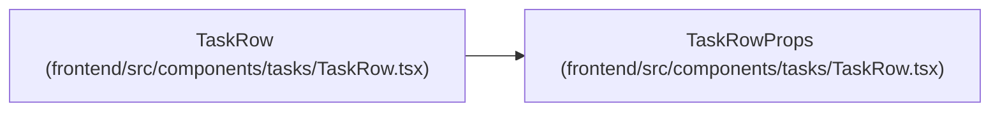

# TaskRowProps

**Location:** `frontend/src/components/tasks/TaskRow.tsx:21`
**Kind:** Interface
**Bases:** —
**Module:** [TaskRow](../modules/TaskRow.md)

## Description

_Auto-generated from `TaskRowProps` in `frontend/src/components/tasks/TaskRow.tsx`._

## Attributes

| Name | Type | Required | Default | Description |
|------|------|----------|---------|-------------|
| `id` | `number` | Yes | — | — |
| `title` | `string` | Yes | — | — |
| `titleText` | `string` | No | — | — |
| `status` | `TaskStatus` | Yes | — | — |
| `state` | `TaskDisplayedState` | No | — | — |
| `successor` | `{ id: number; onOpen: () => void } \| null` | No | — | — |
| `statusLocked` | `boolean` | No | — | — |
| `priority` | `number \| null` | No | — | — |
| `chip` | `TaskStateChip \| null` | No | — | — |
| `meta` | `ReactNode` | No | — | — |
| `reasons` | `string[]` | No | — | — |
| `assignee` | `{ id?: number; name: string; kind?: TaskRowAssigneeOption['kind'] \| null } \| null` | No | — | — |
| `assigneeOptions` | `TaskRowAssigneeOption[]` | No | — | — |
| `onAssign` | `(assigneeId: number \| null) => void` | No | — | — |
| `effort` | `number \| null` | No | — | — |
| `level` | `number` | No | — | — |
| `lead` | `ReactNode` | No | — | — |
| `handle` | `ReactNode` | No | — | — |
| `revealed` | `boolean` | No | — | — |
| `onOpen` | `() => void` | Yes | — | — |
| `onStatusChange` | `(status: TaskStatus) => void` | No | — | — |
| `menuItems` | `OverflowMenuItem[]` | Yes | — | — |
| `selected` | `boolean` | No | — | — |
| `onToggleSelect` | `(options: { shiftKey: boolean }) => void` | No | — | — |
| `selectDisabledReason` | `string` | No | — | — |
| `dispatch` | `AgentDispatchState \| null` | No | — | — |
| `reviewer` | `{ name: string \| null } \| null` | No | — | — |
| `overdue` | `boolean` | No | — | — |
| `deferred` | `boolean` | No | — | — |
| `className` | `string` | No | — | — |

## Methods

*No declared methods.*

## Relationships

<!-- Auto-generated relationship summary. Do not edit by hand. -->

### Summary

| Module | Methods | Attributes |
|---|---:|---|
| [TaskRow](../modules/TaskRow.md) | 0 | `assignee`, `assigneeOptions`, `chip`, `className`, `deferred`, `dispatch`, `effort`, `handle`, `id`, `lead`, `level`, `menuItems` |

### References

| Reference | Kind | Source | Call sites |
|---|---|---|---:|
| `TaskRow` | type_reference | [TaskRow](../modules/TaskRow.md) | — |
