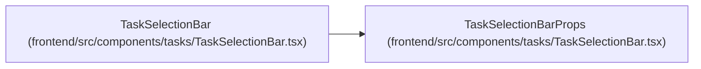

# TaskSelectionBarProps

**Location:** `frontend/src/components/tasks/TaskSelectionBar.tsx:6`
**Kind:** Interface
**Bases:** —
**Module:** [TaskSelectionBar](../modules/TaskSelectionBar.md)

## Description

_Auto-generated from `TaskSelectionBarProps` in `frontend/src/components/tasks/TaskSelectionBar.tsx`._

## Attributes

| Name | Type | Required | Default | Description |
|------|------|----------|---------|-------------|
| `iterationId` | `number` | Yes | — | — |
| `selectedTasks` | `BulkSelectedTask[]` | Yes | — | — |
| `matchingCount` | `number` | Yes | — | — |
| `onSelectAll` | `() => void` | Yes | — | — |
| `onClearSelection` | `() => void` | Yes | — | — |
| `openAssign` | `boolean` | No | — | — |

## Methods

*No declared methods.*

## Relationships

<!-- Auto-generated relationship summary. Do not edit by hand. -->

### Summary

| Module | Methods | Attributes |
|---|---:|---|
| [TaskSelectionBar](../modules/TaskSelectionBar.md) | 0 | `iterationId`, `matchingCount`, `onClearSelection`, `onSelectAll`, `openAssign`, `selectedTasks` |

### References

| Reference | Kind | Source | Call sites |
|---|---|---|---:|
| `TaskSelectionBar` | type_reference | [TaskSelectionBar](../modules/TaskSelectionBar.md) | — |
