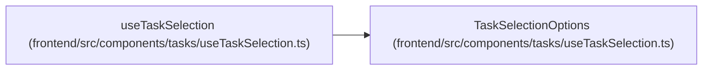

# TaskSelectionOptions

**Location:** `frontend/src/components/tasks/useTaskSelection.ts:3`
**Kind:** Interface
**Bases:** —
**Module:** [useTaskSelection](../modules/useTaskSelection.md)

## Description

_Auto-generated from `TaskSelectionOptions` in `frontend/src/components/tasks/useTaskSelection.ts`._

## Attributes

| Name | Type | Required | Default | Description |
|------|------|----------|---------|-------------|
| `selectableIds` | `Set<number>` | Yes | — | — |
| `order` | `number[]` | Yes | — | — |
| `iterationOf` | `(taskId: number) => number \| null \| undefined` | No | — | — |

## Methods

*No declared methods.*

## Relationships

<!-- Auto-generated relationship summary. Do not edit by hand. -->

### Summary

| Module | Methods | Attributes |
|---|---:|---|
| [useTaskSelection](../modules/useTaskSelection.md) | 0 | `iterationOf`, `order`, `selectableIds` |

### References

| Reference | Kind | Source | Call sites |
|---|---|---|---:|
| `useTaskSelection` | type_reference | [useTaskSelection](../modules/useTaskSelection.md) | — |
