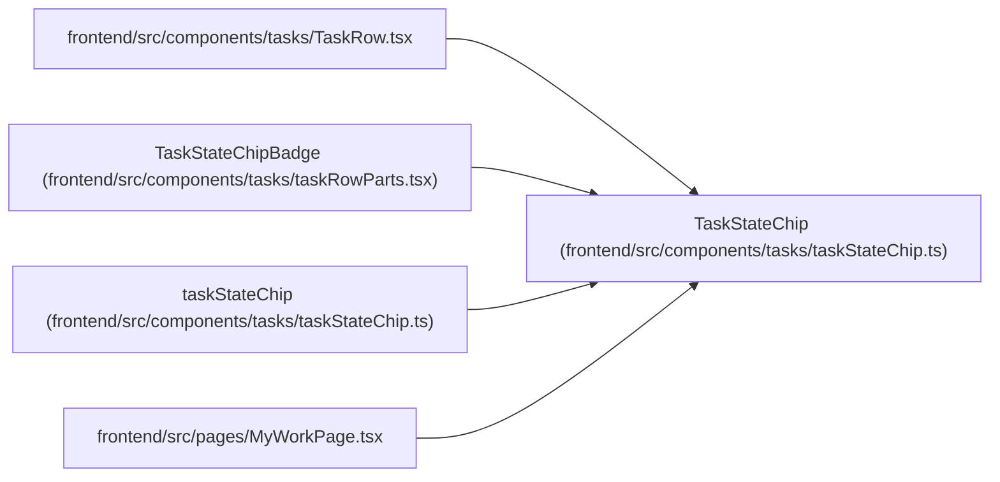

# TaskStateChip

**Location:** `frontend/src/components/tasks/taskStateChip.ts:4`
**Kind:** Type alias
**Bases:** —
**Module:** [taskStateChip](../modules/taskStateChip.md)
**Target:**

```typescript
| { kind: 'blocked' }
    | { kind: 'needsDefinition' }
    | { kind: 'waits'; count: number }
    | { kind: 'ready' }
    | { kind: 'inReview' }
```

## Description

The one state a row names, chosen by priority: Blocked, Needs definition, Waits for n, Ready to start, In review.

## Attributes

*See the alias definition for its member types.*

## Methods

*See the alias definition for callable and member types.*

## Relationships

<!-- Auto-generated relationship summary. Do not edit by hand. -->


### Summary

| Module | Methods | Attributes |
|---|---:|---|
| [taskStateChip](../modules/taskStateChip.md) | 0 | — |

### References

| Reference | Kind | Source | Call sites |
|---|---|---|---:|
| `TaskRow` | import | [TaskRow](../modules/TaskRow.md) | — |
| `TaskStateChipBadge` | type_reference | [taskRowParts](../modules/taskRowParts.md) | — |
| `taskStateChip` | type_reference | [taskStateChip](../modules/taskStateChip.md) | — |
| `MyWorkPage` | import | [MyWorkPage](../modules/MyWorkPage.md) | — |
