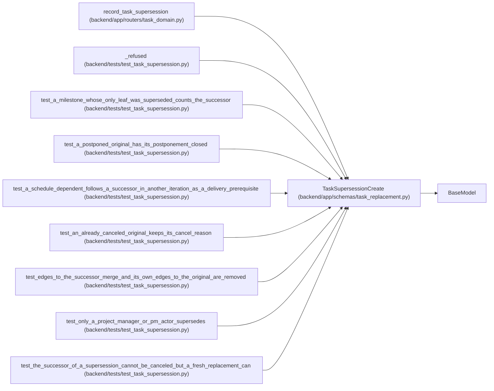

# TaskSupersessionCreate

**Location:** `backend/app/schemas/task_replacement.py:41`
**Kind:** Pydantic model
**Bases:** `BaseModel`
**Module:** [schemas_task_replacement](../modules/schemas_task_replacement.md)

## Description

Record that work already closed or accepted delivered this original's deliverable.

## Model Configuration

| Setting | Value | Source |
|---------|-------|--------|
| `extra` | `'forbid'` | model_config |

## Validators

| Method | Scope | Fields | Mode | Options |
|--------|-------|--------|------|---------|
| `_stripped` | field | reason | after | — |

## Attributes

| Name | Type | Wire name | Required | Nullable | Default | Constraints | Examples | Description |
|------|------|-----------|----------|----------|---------|-------------|-------------|----------|
| `successor_task_id` | `int` | `successor_task_id` | Yes | No | — | ge=1 | — | Closed or accepted leaf task in the same project. |
| `expected_original_version` | `int` | `expected_original_version` | Yes | No | — | ge=1 | — | — |
| `expected_successor_version` | `int` | `expected_successor_version` | Yes | No | — | ge=1 | — | — |
| `reason` | `str` | `reason` | Yes | No | — | max_length=4000; min_length=1 | — | Why the successor delivers the original's work. |

## Methods

| Method | Signature | Decorators | Description |
|--------|-----------|------------|-------------|
| `_stripped` | `(value: str) -> str` | `@field_validator('reason')`, `@classmethod` | — |

## Relationships

<!-- Auto-generated relationship summary. Do not edit by hand. -->

### Summary

| Module | Methods | Attributes |
|---|---:|---|
| [schemas_task_replacement](../modules/schemas_task_replacement.md) | 1 | `expected_original_version`, `expected_successor_version`, `reason`, `successor_task_id` |

### Structure

| Kind | Entity | Module |
|---|---|---|
| Base | `BaseModel` | — |

### References

| Reference | Kind | Source | Call sites |
|---|---|---|---:|
| `record_task_supersession` | type_reference | [routers_task_domain](../modules/routers_task_domain.md) | — |
| `_refused` | call | [test_task_supersession](../modules/test_task_supersession.md) | 1 |
| `test_a_milestone_whose_only_leaf_was_superseded_counts_the_successor` | call | [test_task_supersession](../modules/test_task_supersession.md) | 1 |
| `test_a_postponed_original_has_its_postponement_closed` | call | [test_task_supersession](../modules/test_task_supersession.md) | 1 |
| `test_a_schedule_dependent_follows_a_successor_in_another_iteration_as_a_delivery_prerequisite` | call | [test_task_supersession](../modules/test_task_supersession.md) | 1 |
| `test_an_already_canceled_original_keeps_its_cancel_reason` | call | [test_task_supersession](../modules/test_task_supersession.md) | 1 |
| `test_edges_to_the_successor_merge_and_its_own_edges_to_the_original_are_removed` | call | [test_task_supersession](../modules/test_task_supersession.md) | 1 |
| `test_only_a_project_manager_or_pm_actor_supersedes` | call | [test_task_supersession](../modules/test_task_supersession.md) | 1 |
| `test_the_successor_of_a_supersession_cannot_be_canceled_but_a_fresh_replacement_can` | call | [test_task_supersession](../modules/test_task_supersession.md) | 1 |
