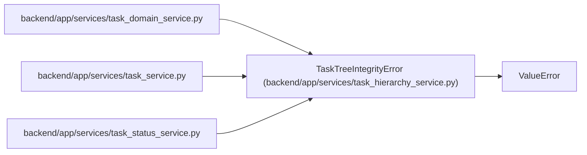

# TaskTreeIntegrityError

**Location:** `backend/app/services/task_hierarchy_service.py:9`
**Kind:** Class
**Bases:** `ValueError`
**Module:** [task_hierarchy_service](../modules/task_hierarchy_service.md)

## Description

Raised when persisted task parent links cannot form a valid iteration tree.

## Attributes

*No annotated attributes found.*

## Methods

*No declared methods.*

## Relationships

<!-- Auto-generated relationship summary. Do not edit by hand. -->

### Summary

| Module | Methods | Attributes |
|---|---:|---|
| [task_hierarchy_service](../modules/task_hierarchy_service.md) | 0 | — |

### Structure

| Kind | Entity | Module |
|---|---|---|
| Base | `ValueError` | — |

### References

| Reference | Kind | Source | Call sites |
|---|---|---|---:|
| `task_domain_service` | import | [task_domain_service](../modules/task_domain_service.md) | — |
| `task_service` | import | [task_service](../modules/task_service.md) | — |
| `task_status_service` | import | [task_status_service](../modules/task_status_service.md) | — |
