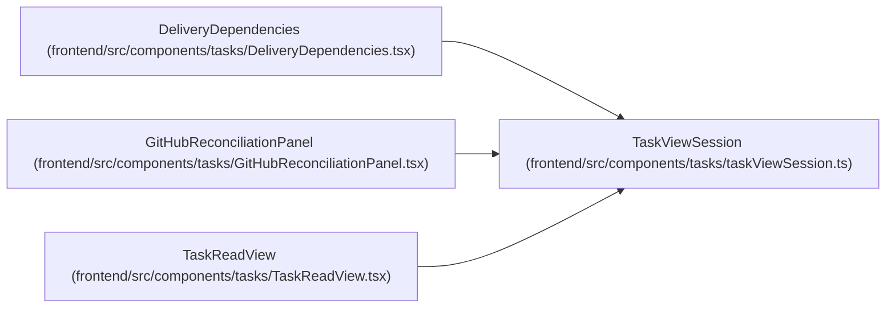

# TaskViewSession

**Location:** `frontend/src/components/tasks/taskViewSession.ts:7`
**Kind:** Interface
**Bases:** —
**Module:** [taskViewSession](../modules/taskViewSession.md)

## Description

What a person was doing in the task view's panels. The view remounts whenever the task version
changes, so the drawer holds this for as long as it is open. It is memory only: it ends with the drawer.

## Attributes

| Name | Type | Required | Default | Description |
|------|------|----------|---------|-------------|
| `prerequisitesOpen` | `boolean` | Yes | — | — |
| `branchConflict` | `boolean` | Yes | — | — |
| `catchUpDone` | `boolean` | Yes | — | — |

## Methods

*No declared methods.*

## Relationships

<!-- Auto-generated relationship summary. Do not edit by hand. -->

### Summary

| Module | Methods | Attributes |
|---|---:|---|
| [taskViewSession](../modules/taskViewSession.md) | 0 | `branchConflict`, `catchUpDone`, `prerequisitesOpen` |

### References

| Reference | Kind | Source | Call sites |
|---|---|---|---:|
| `DeliveryDependencies` | type_reference | [DeliveryDependencies](../modules/DeliveryDependencies.md) | — |
| `GitHubReconciliationPanel` | type_reference | [GitHubReconciliationPanel](../modules/GitHubReconciliationPanel.md) | — |
| `TaskReadView` | type_reference | [TaskReadView](../modules/TaskReadView.md) | — |
