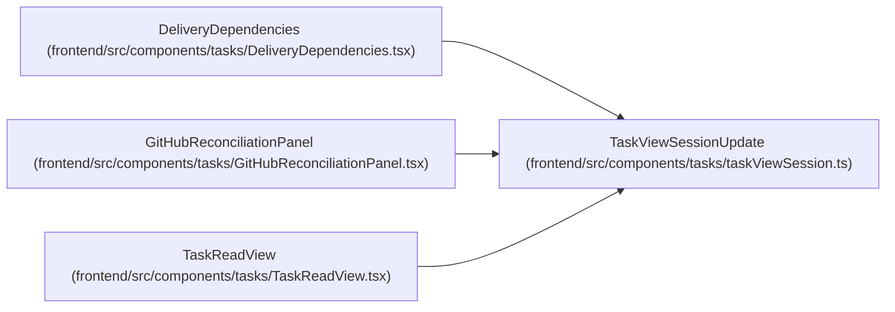

# TaskViewSessionUpdate

**Location:** `frontend/src/components/tasks/taskViewSession.ts:8`
**Kind:** Type alias
**Bases:** —
**Module:** [taskViewSession](../modules/taskViewSession.md)
**Target:**

```typescript
(patch: Partial<TaskViewSession>) => void
```

## Description

Merges a partial change into the task view's session state.

## Attributes

*See the alias definition for its member types.*

## Methods

*See the alias definition for callable and member types.*

## Relationships

<!-- Auto-generated relationship summary. Do not edit by hand. -->


### Summary

| Module | Methods | Attributes |
|---|---:|---|
| [taskViewSession](../modules/taskViewSession.md) | 0 | — |

### References

| Reference | Kind | Source | Call sites |
|---|---|---|---:|
| `DeliveryDependencies` | type_reference | [DeliveryDependencies](../modules/DeliveryDependencies.md) | — |
| `GitHubReconciliationPanel` | type_reference | [GitHubReconciliationPanel](../modules/GitHubReconciliationPanel.md) | — |
| `TaskReadView` | type_reference | [TaskReadView](../modules/TaskReadView.md) | — |
