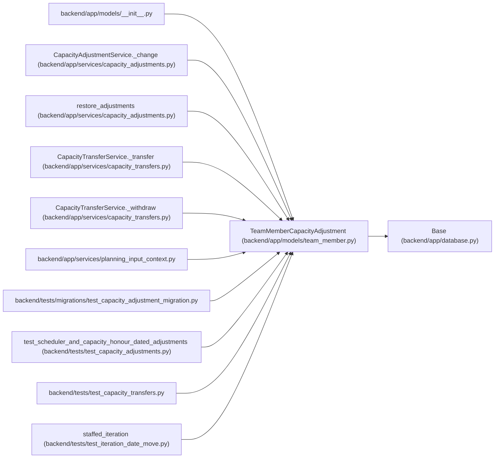

# TeamMemberCapacityAdjustment

**Location:** `backend/app/models/team_member.py:191`
**Kind:** Class
**Bases:** `Base`
**Module:** [team_member](../modules/team_member.md)

## Description

A dated replacement of one capacity row's availability percentage.

On each date from ``start_date`` through ``end_date`` the row counts
``availability_percent`` instead of its own percentage; every other date keeps
the row's percentage. Rows are never edited: a change withdraws an adjustment
and records a new one, so the prior value and who changed it stay readable.
Adjustments recorded by one command share ``group_token`` (for example both
rows of a capacity transfer).

## Attributes

| Name | Type | Default | Description |
|------|------|---------|-------------|
| `id` | `Mapped[int]` | `mapped_column(Integer, primary_key=True, autoincrement=True)` | — |
| `team_member_id` | `Mapped[int]` | `mapped_column(Integer, ForeignKey('team_members.id', ondelete='CASCADE'), nullable=False)` | — |
| `start_date` | `Mapped[date]` | `mapped_column(Date, nullable=False)` | — |
| `end_date` | `Mapped[date]` | `mapped_column(Date, nullable=False)` | — |
| `availability_percent` | `Mapped[float]` | `mapped_column(Float, nullable=False)` | — |
| `base_availability_percent` | `Mapped[float]` | `mapped_column(Float, nullable=False)` | — |
| `reason` | `Mapped[str]` | `mapped_column(Text, nullable=False)` | — |
| `group_token` | `Mapped[str]` | `mapped_column(String(36), nullable=False)` | — |
| `created_by_principal_id` | `Mapped[int \| None]` | `mapped_column(ForeignKey('principals.id', ondelete='SET NULL'), nullable=True)` | — |
| `created_at` | `Mapped[datetime]` | `mapped_column(UTCDateTime(), default=utc_now, nullable=False)` | — |
| `withdrawn_at` | `Mapped[datetime \| None]` | `mapped_column(UTCDateTime(), nullable=True)` | — |
| `withdrawn_by_principal_id` | `Mapped[int \| None]` | `mapped_column(ForeignKey('principals.id', ondelete='SET NULL'), nullable=True)` | — |
| `withdrawal_reason` | `Mapped[str \| None]` | `mapped_column(Text, nullable=True)` | — |
| `withdrawn_group_token` | `Mapped[str \| None]` | `mapped_column(String(36), nullable=True)` | — |

## Methods

*No declared methods.*

## Relationships

<!-- Auto-generated relationship summary. Do not edit by hand. -->

### Summary

| Module | Methods | Attributes |
|---|---:|---|
| [team_member](../modules/team_member.md) | 0 | `availability_percent`, `base_availability_percent`, `created_at`, `created_by_principal_id`, `end_date`, `group_token`, `id`, `reason`, `start_date`, `team_member_id`, `withdrawal_reason`, `withdrawn_at` |

### Structure

| Kind | Entity | Module |
|---|---|---|
| Base | `Base` | [app_database](../modules/app_database.md) |

### References

| Reference | Kind | Source | Call sites |
|---|---|---|---:|
| `__init__` | import | [models___init__](../modules/models___init__.md) | — |
| `CapacityAdjustmentService._change` | call | [capacity_adjustments](../modules/capacity_adjustments.md) | 1 |
| `restore_adjustments` | call | [capacity_adjustments](../modules/capacity_adjustments.md) | 1 |
| `CapacityTransferService._transfer` | call | [capacity_transfers](../modules/capacity_transfers.md) | 1 |
| `CapacityTransferService._withdraw` | call | [capacity_transfers](../modules/capacity_transfers.md) | 1 |
| `planning_input_context` | import | [planning_input_context](../modules/planning_input_context.md) | — |
| `test_capacity_adjustment_migration` | import | [test_capacity_adjustment_migration](../modules/test_capacity_adjustment_migration.md) | — |
| `test_scheduler_and_capacity_honour_dated_adjustments` | call | [test_capacity_adjustments](../modules/test_capacity_adjustments.md) | 2 |
| `test_capacity_transfers` | import | [test_capacity_transfers](../modules/test_capacity_transfers.md) | — |
| `staffed_iteration` | call | [test_iteration_date_move](../modules/test_iteration_date_move.md) | 1 |
