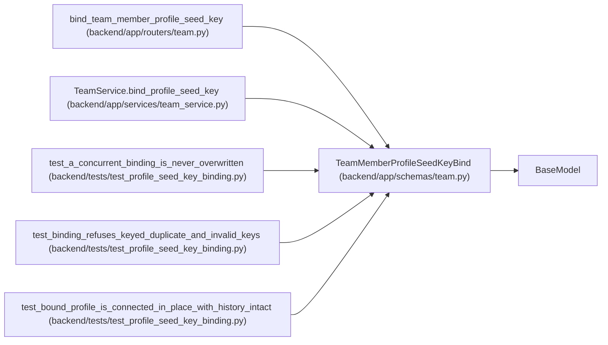

# TeamMemberProfileSeedKeyBind

**Location:** `backend/app/schemas/team.py:253`
**Kind:** Pydantic model
**Bases:** `BaseModel`
**Module:** [schemas_team](../modules/schemas_team.md)

## Description

Operator request that binds a stable seed key to a profile that has none.

## Validators

| Method | Scope | Fields | Mode | Options |
|--------|-------|--------|------|---------|
| `trim_text` | field | seed_key, reason | after | — |

## Attributes

| Name | Type | Wire name | Required | Nullable | Default | Constraints | Examples | Description |
|------|------|-----------|----------|----------|---------|-------------|-------------|----------|
| `seed_key` | `str` | `seed_key` | Yes | No | — | min_length=1; max_length=100; pattern=unknown (STABLE_KEY_PATTERN) | — | — |
| `reason` | `Optional[str]` | `reason` | No | Yes | `None` | max_length=500 | — | — |

## Methods

| Method | Signature | Decorators | Description |
|--------|-----------|------------|-------------|
| `trim_text` | `(value: Optional[str]) -> Optional[str]` | `@field_validator('seed_key', 'reason', mode='after')`, `@classmethod` | — |

## Relationships

<!-- Auto-generated relationship summary. Do not edit by hand. -->

### Summary

| Module | Methods | Attributes |
|---|---:|---|
| [schemas_team](../modules/schemas_team.md) | 1 | `reason`, `seed_key` |

### Structure

| Kind | Entity | Module |
|---|---|---|
| Base | `BaseModel` | — |

### References

| Reference | Kind | Source | Call sites |
|---|---|---|---:|
| `bind_team_member_profile_seed_key` | type_reference | [routers_team](../modules/routers_team.md) | — |
| `TeamService.bind_profile_seed_key` | type_reference | [team_service](../modules/team_service.md) | — |
| `test_a_concurrent_binding_is_never_overwritten` | call | [test_profile_seed_key_binding](../modules/test_profile_seed_key_binding.md) | 2 |
| `test_binding_refuses_keyed_duplicate_and_invalid_keys` | call | [test_profile_seed_key_binding](../modules/test_profile_seed_key_binding.md) | 4 |
| `test_bound_profile_is_connected_in_place_with_history_intact` | call | [test_profile_seed_key_binding](../modules/test_profile_seed_key_binding.md) | 2 |
