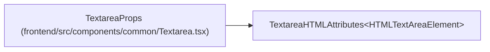

# TextareaProps

**Location:** `frontend/src/components/common/Textarea.tsx:6`
**Kind:** Interface
**Bases:** `TextareaHTMLAttributes<HTMLTextAreaElement>`
**Module:** [Textarea](../modules/Textarea.md)

## Description

_Auto-generated from `TextareaProps` in `frontend/src/components/common/Textarea.tsx`._

## Attributes

| Name | Type | Required | Default | Description |
|------|------|----------|---------|-------------|
| `label` | `ReactNode` | No | — | — |
| `help` | `ReactNode` | No | — | — |
| `error` | `string` | No | — | — |

## Methods

*No declared methods.*

## Relationships

<!-- Auto-generated relationship summary. Do not edit by hand. -->

### Summary

| Module | Methods | Attributes |
|---|---:|---|
| [Textarea](../modules/Textarea.md) | 0 | `error`, `help`, `label` |

### Structure

| Kind | Entity | Module |
|---|---|---|
| Base | `TextareaHTMLAttributes<HTMLTextAreaElement>` | — |
