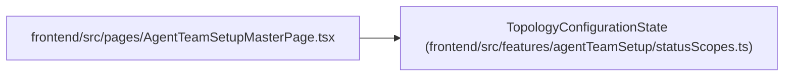

# TopologyConfigurationState

**Location:** `frontend/src/features/agentTeamSetup/statusScopes.ts:3`
**Kind:** Type alias
**Bases:** —
**Module:** [statusScopes](../modules/statusScopes.md)
**Target:**

```typescript
| 'unavailable'
    | 'notConfigured'
    | 'reconciliationNeeded'
    | 'configured'
    | 'disabled'
```

## Description

_Auto-generated from `TopologyConfigurationState` in `frontend/src/features/agentTeamSetup/statusScopes.ts`._

## Attributes

*See the alias definition for its member types.*

## Methods

*See the alias definition for callable and member types.*

## Relationships

<!-- Auto-generated relationship summary. Do not edit by hand. -->


### Summary

| Module | Methods | Attributes |
|---|---:|---|
| [statusScopes](../modules/statusScopes.md) | 0 | — |

### References

| Reference | Kind | Source | Call sites |
|---|---|---|---:|
| `AgentTeamSetupMasterPage` | import | [AgentTeamSetupMasterPage](../modules/AgentTeamSetupMasterPage.md) | — |
