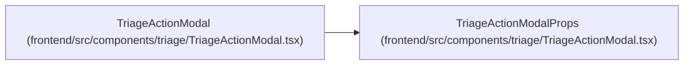

# TriageActionModalProps

**Location:** `frontend/src/components/triage/TriageActionModal.tsx:24`
**Kind:** Interface
**Bases:** —
**Module:** [TriageActionModal](../modules/TriageActionModal.md)

## Description

_Auto-generated from `TriageActionModalProps` in `frontend/src/components/triage/TriageActionModal.tsx`._

## Attributes

| Name | Type | Required | Default | Description |
|------|------|----------|---------|-------------|
| `action` | `TriageLifecycleAction` | Yes | — | — |
| `item` | `TriageItem` | Yes | — | — |
| `allTriageItems` | `TriageItem[]` | Yes | — | — |
| `iterations` | `Iteration[]` | Yes | — | — |
| `selectedIterationId` | `number` | Yes | — | — |
| `defaultSnooze` | `string` | Yes | — | — |
| `defaultDuplicate` | `DuplicateActionDefaults` | No | — | — |
| `isSubmitting` | `boolean` | Yes | — | — |
| `error` | `string \| null` | No | — | — |
| `onSubmit` | `(payload: TriageActionRequest \| TriageSnoozeRequest \| TriageDuplicateRequest) => void` | Yes | — | — |
| `onClose` | `() => void` | Yes | — | — |

## Methods

*No declared methods.*

## Relationships

<!-- Auto-generated relationship summary. Do not edit by hand. -->

### Summary

| Module | Methods | Attributes |
|---|---:|---|
| [TriageActionModal](../modules/TriageActionModal.md) | 0 | `action`, `allTriageItems`, `defaultDuplicate`, `defaultSnooze`, `error`, `isSubmitting`, `item`, `iterations`, `onClose`, `onSubmit`, `selectedIterationId` |

### References

| Reference | Kind | Source | Call sites |
|---|---|---|---:|
| `TriageActionModal` | type_reference | [TriageActionModal](../modules/TriageActionModal.md) | — |
