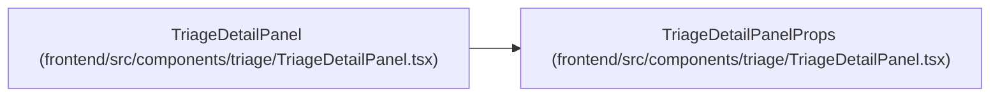

# TriageDetailPanelProps

**Location:** `frontend/src/components/triage/TriageDetailPanel.tsx:27`
**Kind:** Interface
**Bases:** —
**Module:** [TriageDetailPanel](../modules/TriageDetailPanel.md)

## Description

_Auto-generated from `TriageDetailPanelProps` in `frontend/src/components/triage/TriageDetailPanel.tsx`._

## Attributes

| Name | Type | Required | Default | Description |
|------|------|----------|---------|-------------|
| `item` | `TriageItem \| null` | Yes | — | — |
| `projectsById` | `Record<number, string>` | Yes | — | — |
| `iterationsById` | `Record<number, string>` | Yes | — | — |
| `canConvert` | `boolean` | Yes | — | — |
| `onAction` | `(action: TriageLifecycleAction, item: TriageItem) => void` | Yes | — | — |
| `onMarkSuggestion` | `(item: TriageItem, suggestion: TriageDuplicateSuggestion) => void` | Yes | — | — |
| `onConvert` | `(item: TriageItem) => void` | Yes | — | — |
| `onRequestLinksChanged` | `() => void` | Yes | — | — |

## Methods

*No declared methods.*

## Relationships

<!-- Auto-generated relationship summary. Do not edit by hand. -->

### Summary

| Module | Methods | Attributes |
|---|---:|---|
| [TriageDetailPanel](../modules/TriageDetailPanel.md) | 0 | `canConvert`, `item`, `iterationsById`, `onAction`, `onConvert`, `onMarkSuggestion`, `onRequestLinksChanged`, `projectsById` |

### References

| Reference | Kind | Source | Call sites |
|---|---|---|---:|
| `TriageDetailPanel` | type_reference | [TriageDetailPanel](../modules/TriageDetailPanel.md) | — |
