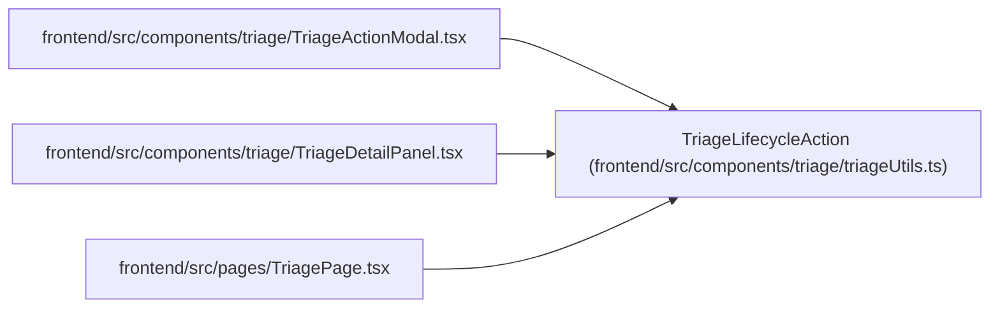

# TriageLifecycleAction

**Location:** `frontend/src/components/triage/triageUtils.ts:146`
**Kind:** Type alias
**Bases:** —
**Module:** [triageUtils](../modules/triageUtils.md)
**Target:**

```typescript
'accept' | 'decline' | 'snooze' | 'clarify' | 'duplicate'
```

## Description

_Auto-generated from `TriageLifecycleAction` in `frontend/src/components/triage/triageUtils.ts`._

## Attributes

*See the alias definition for its member types.*

## Methods

*See the alias definition for callable and member types.*

## Relationships

<!-- Auto-generated relationship summary. Do not edit by hand. -->


### Summary

| Module | Methods | Attributes |
|---|---:|---|
| [triageUtils](../modules/triageUtils.md) | 0 | — |

### References

| Reference | Kind | Source | Call sites |
|---|---|---|---:|
| `TriageActionModal` | import | [TriageActionModal](../modules/TriageActionModal.md) | — |
| `TriageDetailPanel` | import | [TriageDetailPanel](../modules/TriageDetailPanel.md) | — |
| `TriagePage` | import | [TriagePage](../modules/TriagePage.md) | — |
