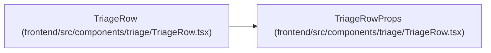

# TriageRowProps

**Location:** `frontend/src/components/triage/TriageRow.tsx:12`
**Kind:** Interface
**Bases:** —
**Module:** [TriageRow](../modules/TriageRow.md)

## Description

_Auto-generated from `TriageRowProps` in `frontend/src/components/triage/TriageRow.tsx`._

## Attributes

| Name | Type | Required | Default | Description |
|------|------|----------|---------|-------------|
| `item` | `TriageItem` | Yes | — | — |
| `isSelected` | `boolean` | Yes | — | — |
| `projectsById` | `Record<number, string>` | Yes | — | — |
| `iterationsById` | `Record<number, string>` | Yes | — | — |
| `onSelect` | `(id: number) => void` | Yes | — | — |

## Methods

*No declared methods.*

## Relationships

<!-- Auto-generated relationship summary. Do not edit by hand. -->

### Summary

| Module | Methods | Attributes |
|---|---:|---|
| [TriageRow](../modules/TriageRow.md) | 0 | `isSelected`, `item`, `iterationsById`, `onSelect`, `projectsById` |

### References

| Reference | Kind | Source | Call sites |
|---|---|---|---:|
| `TriageRow` | type_reference | [TriageRow](../modules/TriageRow.md) | — |
