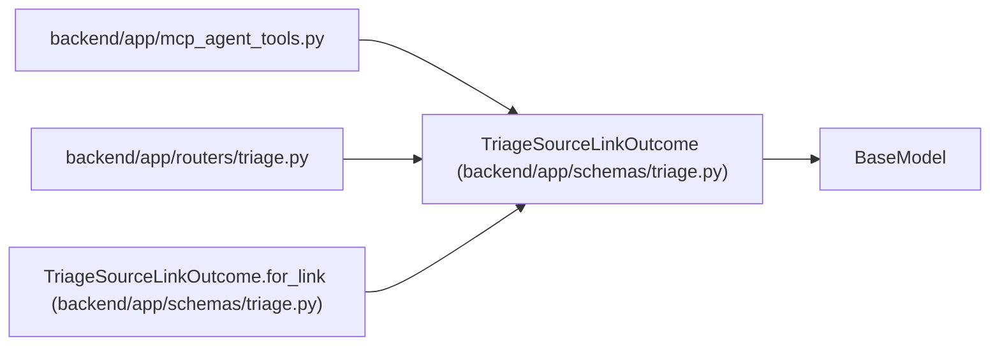

# TriageSourceLinkOutcome

**Location:** `backend/app/schemas/triage.py:301`
**Kind:** Pydantic model
**Bases:** `BaseModel`
**Module:** [schemas_triage](../modules/schemas_triage.md)

## Description

What conversion did with the intake's source link when it was not carried over unchanged.

## Attributes

| Name | Type | Wire name | Required | Nullable | Default | Constraints | Examples | Description |
|------|------|-----------|----------|----------|---------|-------------|-------------|----------|
| `action` | `Literal['rewritten', 'dropped']` | `action` | Yes | No | — | — | — | — |
| `original` | `Optional[str]` | `original` | No | Yes | `None` | — | — | — |
| `task_source_url` | `Optional[str]` | `task_source_url` | No | Yes | `None` | — | — | — |
| `message` | `str` | `message` | Yes | No | — | — | — | — |

## Methods

| Method | Signature | Decorators | Description |
|--------|-----------|------------|-------------|
| `for_link` | `(source_url: Optional[str]) -> Optional['TriageSourceLinkOutcome']` | `@classmethod` | — |

## Relationships

<!-- Auto-generated relationship summary. Do not edit by hand. -->

### Summary

| Module | Methods | Attributes |
|---|---:|---|
| [schemas_triage](../modules/schemas_triage.md) | 1 | `action`, `message`, `original`, `task_source_url` |

### Structure

| Kind | Entity | Module |
|---|---|---|
| Base | `BaseModel` | — |

### References

| Reference | Kind | Source | Call sites |
|---|---|---|---:|
| `mcp_agent_tools` | import | [mcp_agent_tools](../modules/mcp_agent_tools.md) | — |
| `triage` | import | [routers_triage](../modules/routers_triage.md) | — |
| `TriageSourceLinkOutcome.for_link` | call | [schemas_triage](../modules/schemas_triage.md) | 1 |
| `TriageSourceLinkOutcome.for_link` | type_reference | [schemas_triage](../modules/schemas_triage.md) | — |
