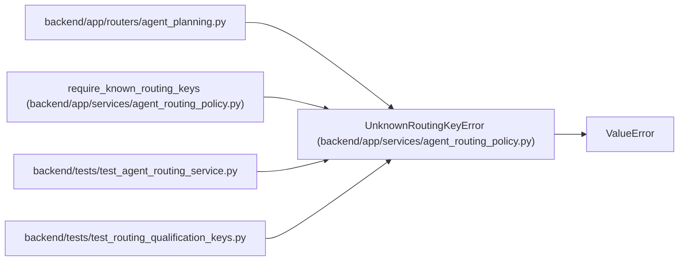

# UnknownRoutingKeyError

**Location:** `backend/app/services/agent_routing_policy.py:492`
**Kind:** Class
**Bases:** `ValueError`
**Module:** [agent_routing_policy](../modules/agent_routing_policy.md)

## Description

A key is neither a built-in routing skill key nor a declared qualification key.

## Attributes

*No annotated attributes found.*

## Methods

| Method | Signature | Decorators | Description |
|--------|-----------|------------|-------------|
| `__init__` | `(keys: Iterable[str])` | — | — |

## Relationships

<!-- Auto-generated relationship summary. Do not edit by hand. -->

### Summary

| Module | Methods | Attributes |
|---|---:|---|
| [agent_routing_policy](../modules/agent_routing_policy.md) | 1 | — |

### Structure

| Kind | Entity | Module |
|---|---|---|
| Base | `ValueError` | — |

### References

| Reference | Kind | Source | Call sites |
|---|---|---|---:|
| `agent_planning` | import | [routers_agent_planning](../modules/routers_agent_planning.md) | — |
| `require_known_routing_keys` | call | [agent_routing_policy](../modules/agent_routing_policy.md) | 1 |
| `test_agent_routing_service` | import | [test_agent_routing_service](../modules/test_agent_routing_service.md) | — |
| `test_routing_qualification_keys` | import | [test_routing_qualification_keys](../modules/test_routing_qualification_keys.md) | — |
