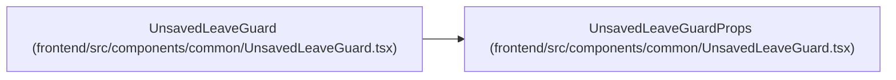

# UnsavedLeaveGuardProps

**Location:** `frontend/src/components/common/UnsavedLeaveGuard.tsx:5`
**Kind:** Interface
**Bases:** —
**Module:** [UnsavedLeaveGuard](../modules/UnsavedLeaveGuard.md)

## Description

_Auto-generated from `UnsavedLeaveGuardProps` in `frontend/src/components/common/UnsavedLeaveGuard.tsx`._

## Attributes

| Name | Type | Required | Default | Description |
|------|------|----------|---------|-------------|
| `when` | `boolean` | Yes | — | — |
| `title` | `string` | Yes | — | — |
| `description` | `string` | Yes | — | — |
| `leaveLabel` | `string` | Yes | — | — |
| `stayLabel` | `string` | Yes | — | — |
| `closeLabel` | `string` | Yes | — | — |

## Methods

*No declared methods.*

## Relationships

<!-- Auto-generated relationship summary. Do not edit by hand. -->

### Summary

| Module | Methods | Attributes |
|---|---:|---|
| [UnsavedLeaveGuard](../modules/UnsavedLeaveGuard.md) | 0 | `closeLabel`, `description`, `leaveLabel`, `stayLabel`, `title`, `when` |

### References

| Reference | Kind | Source | Call sites |
|---|---|---|---:|
| `UnsavedLeaveGuard` | type_reference | [UnsavedLeaveGuard](../modules/UnsavedLeaveGuard.md) | — |
