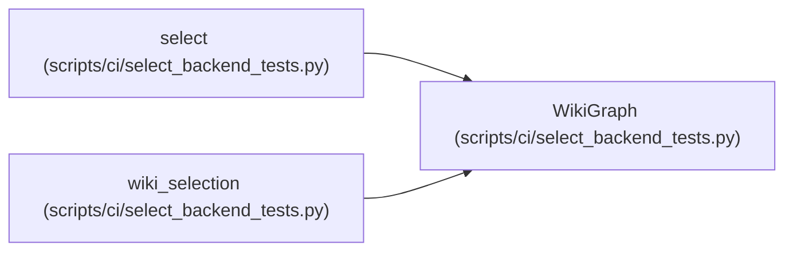

# WikiGraph

**Location:** `scripts/ci/select_backend_tests.py:466`
**Kind:** Class
**Bases:** —
**Module:** [select_backend_tests](../modules/select_backend_tests.md)

## Description

Read-only llm-wiki queries; never syncs or writes the wiki.

## Attributes

*No annotated attributes found.*

## Methods

| Method | Signature | Decorators | Description |
|--------|-----------|------------|-------------|
| `__init__` | `(root: Path) -> None` | — | — |
| `impact_each` | `(paths: list[str]) -> Iterable[tuple[str, dict[str, Any]]]` | — | Run one impact query per path, in parallel processes. |
| `incoming_imports` | `(locator: str) -> dict[str, Any]` | — | — |

## Relationships

<!-- Auto-generated relationship summary. Do not edit by hand. -->

### Summary

| Module | Methods | Attributes |
|---|---:|---|
| [select_backend_tests](../modules/select_backend_tests.md) | 3 | — |

### References

| Reference | Kind | Source | Call sites |
|---|---|---|---:|
| `select` | type_reference | [select_backend_tests](../modules/select_backend_tests.md) | — |
| `wiki_selection` | call | [select_backend_tests](../modules/select_backend_tests.md) | 1 |
| `wiki_selection` | type_reference | [select_backend_tests](../modules/select_backend_tests.md) | — |
