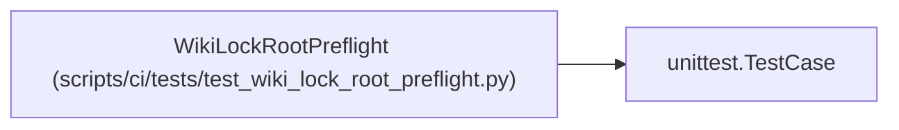

# WikiLockRootPreflight

**Location:** `scripts/ci/tests/test_wiki_lock_root_preflight.py:43`
**Kind:** Class
**Bases:** `unittest.TestCase`
**Module:** [test_wiki_lock_root_preflight](../modules/test_wiki_lock_root_preflight.md)

## Description

_Auto-generated from `WikiLockRootPreflight` in `scripts/ci/tests/test_wiki_lock_root_preflight.py`._

## Attributes

*No annotated attributes found.*

## Methods

| Method | Signature | Decorators | Description |
|--------|-----------|------------|-------------|
| `setUp` | `()` | — | — |
| `tearDown` | `()` | — | — |
| `test_linked_worktree_nested_in_other_checkout_is_refused` | `()` | — | — |
| `test_symlinked_git_nested_in_other_checkout_is_refused` | `()` | — | — |
| `test_standalone_clone_passes` | `()` | — | — |
| `test_isolated_clone_nested_in_other_checkout_passes` | `()` | — | — |
| `test_normal_checkout_passes` | `()` | — | — |
| `test_missing_wiki_directory_is_refused` | `()` | — | — |
| `test_non_git_directory_is_refused` | `()` | — | — |

## Relationships

<!-- Auto-generated relationship summary. Do not edit by hand. -->

### Summary

| Module | Methods | Attributes |
|---|---:|---|
| [test_wiki_lock_root_preflight](../modules/test_wiki_lock_root_preflight.md) | 9 | — |

### Structure

| Kind | Entity | Module |
|---|---|---|
| Base | `unittest.TestCase` | — |
