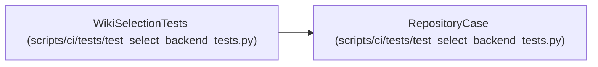

# WikiSelectionTests

**Location:** `scripts/ci/tests/test_select_backend_tests.py:347`
**Kind:** Class
**Bases:** `RepositoryCase`
**Module:** [test_select_backend_tests](../modules/test_select_backend_tests.md)

## Description

_Auto-generated from `WikiSelectionTests` in `scripts/ci/tests/test_select_backend_tests.py`._

## Attributes

*No annotated attributes found.*

## Methods

| Method | Signature | Decorators | Description |
|--------|-----------|------------|-------------|
| `setUp` | `() -> None` | — | — |
| `run_wiki` | `(impact: dict, imports: dict[str, dict])` | — | — |
| `test_clean_wiki_result_is_unioned_with_static_selection` | `() -> None` | — | — |
| `assert_full` | `(impact: dict, imports: dict[str, dict], reason: str) -> None` | — | — |
| `test_truncated_impact_selects_full` | `() -> None` | — | — |
| `test_bounded_impact_selects_full` | `() -> None` | — | — |
| `test_ambiguous_impact_selects_full` | `() -> None` | — | — |
| `test_not_found_selects_full` | `() -> None` | — | — |
| `test_missing_module_concept_selects_full` | `() -> None` | — | — |
| `test_unready_knowledge_selects_full` | `() -> None` | — | — |
| `test_unresolved_import_edge_selects_full` | `() -> None` | — | — |
| `test_truncated_traversal_selects_full` | `() -> None` | — | — |
| `test_query_error_selects_full` | `() -> None` | — | — |
| `test_stale_snapshot_selects_full` | `() -> None` | — | — |
| `test_unavailable_llm_wiki_selects_full` | `() -> None` | — | — |

## Relationships

<!-- Auto-generated relationship summary. Do not edit by hand. -->

### Summary

| Module | Methods | Attributes |
|---|---:|---|
| [test_select_backend_tests](../modules/test_select_backend_tests.md) | 15 | — |

### Structure

| Kind | Entity | Module |
|---|---|---|
| Base | `RepositoryCase` | [test_select_backend_tests](../modules/test_select_backend_tests.md) |
