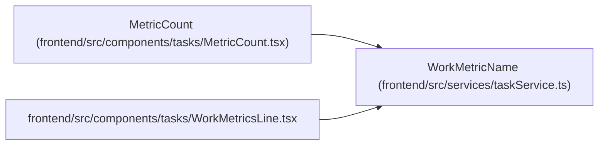

# WorkMetricName

**Location:** `frontend/src/services/taskService.ts:274`
**Kind:** Type alias
**Bases:** —
**Module:** [taskService](../modules/taskService.md)
**Target:**

```typescript
'total' | 'planned' | 'active' | 'resolved' | 'closed' | 'implemented' | 'accepted' | 'blocked'
    | 'overdue' | 'late_start' | 'iteration_overflow' | 'acceptance_unknown' | 'unknown_estimate'
```

## Description

_Auto-generated from `WorkMetricName` in `frontend/src/services/taskService.ts`._

## Attributes

*See the alias definition for its member types.*

## Methods

*See the alias definition for callable and member types.*

## Relationships

<!-- Auto-generated relationship summary. Do not edit by hand. -->


### Summary

| Module | Methods | Attributes |
|---|---:|---|
| [taskService](../modules/taskService.md) | 0 | — |

### References

| Reference | Kind | Source | Call sites |
|---|---|---|---:|
| `MetricCount` | type_reference | [MetricCount](../modules/MetricCount.md) | — |
| `WorkMetricsLine` | import | [WorkMetricsLine](../modules/WorkMetricsLine.md) | — |
