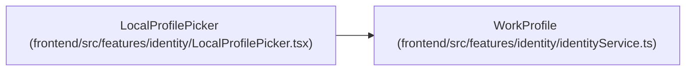

# WorkProfile

**Location:** `frontend/src/features/identity/identityService.ts:4`
**Kind:** Interface
**Bases:** —
**Module:** [identityService](../modules/identityService.md)

## Description

A linked profile is verified; a trusted-local session's own choice is not.

## Attributes

| Name | Type | Required | Default | Description |
|------|------|----------|---------|-------------|
| `id` | `number` | Yes | — | — |
| `display_name` | `string` | Yes | — | — |
| `verified` | `boolean` | No | — | — |

## Methods

*No declared methods.*

## Relationships

<!-- Auto-generated relationship summary. Do not edit by hand. -->

### Summary

| Module | Methods | Attributes |
|---|---:|---|
| [identityService](../modules/identityService.md) | 0 | `display_name`, `id`, `verified` |

### References

| Reference | Kind | Source | Call sites |
|---|---|---|---:|
| `LocalProfilePicker` | type_reference | [LocalProfilePicker](../modules/LocalProfilePicker.md) | — |
