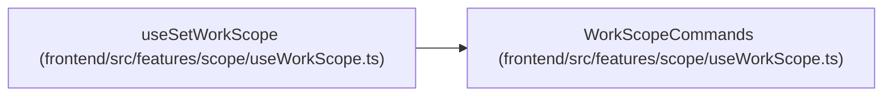

# WorkScopeCommands

**Location:** `frontend/src/features/scope/useWorkScope.ts:43`
**Kind:** Type alias
**Bases:** —
**Module:** [useWorkScope](../modules/useWorkScope.md)
**Target:**

```typescript
Pick<WorkScopeValue, 'setScope' | 'setProject' | 'setIteration'>
```

## Description

_Auto-generated from `WorkScopeCommands` in `frontend/src/features/scope/useWorkScope.ts`._

## Attributes

*See the alias definition for its member types.*

## Methods

*See the alias definition for callable and member types.*

## Relationships

<!-- Auto-generated relationship summary. Do not edit by hand. -->


### Summary

| Module | Methods | Attributes |
|---|---:|---|
| [useWorkScope](../modules/useWorkScope.md) | 0 | — |

### References

| Reference | Kind | Source | Call sites |
|---|---|---|---:|
| `useSetWorkScope` | type_reference | [useWorkScope](../modules/useWorkScope.md) | — |
