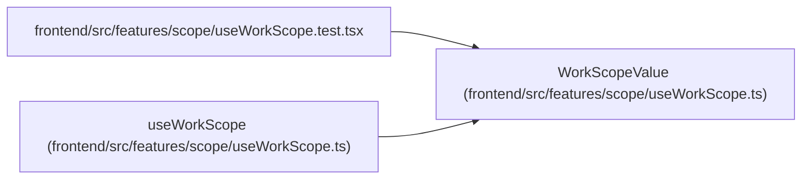

# WorkScopeValue

**Location:** `frontend/src/features/scope/useWorkScope.ts:24`
**Kind:** Interface
**Bases:** —
**Module:** [useWorkScope](../modules/useWorkScope.md)

## Description

_Auto-generated from `WorkScopeValue` in `frontend/src/features/scope/useWorkScope.ts`._

## Attributes

| Name | Type | Required | Default | Description |
|------|------|----------|---------|-------------|
| `scope` | `WorkScope \| undefined` | Yes | — | — |
| `project` | `ScopeProject \| undefined` | Yes | — | — |
| `iteration` | `ScopeIteration \| undefined` | Yes | — | — |
| `isReady` | `boolean` | Yes | — | — |
| `isReadOnly` | `boolean` | Yes | — | — |
| `setScope` | `(next: { project: ScopeProject; iteration?: ScopeIteration }) => void` | Yes | — | — |
| `setProject` | `(project: ScopeProject) => void` | Yes | — | — |
| `setIteration` | `(iteration: ScopeIteration) => void` | Yes | — | — |
| `linkTo` | `(to: string) => string` | Yes | — | — |

## Methods

*No declared methods.*

## Relationships

<!-- Auto-generated relationship summary. Do not edit by hand. -->

### Summary

| Module | Methods | Attributes |
|---|---:|---|
| [useWorkScope](../modules/useWorkScope.md) | 0 | `isReadOnly`, `isReady`, `iteration`, `linkTo`, `project`, `scope`, `setIteration`, `setProject`, `setScope` |

### References

| Reference | Kind | Source | Call sites |
|---|---|---|---:|
| `useWorkScope.test` | import | [useWorkScope.test](../modules/useWorkScope.test.md) | — |
| `useWorkScope` | type_reference | [useWorkScope](../modules/useWorkScope.md) | — |
