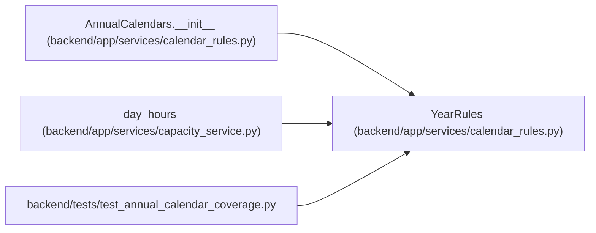

# YearRules

**Location:** `backend/app/services/calendar_rules.py:21`
**Kind:** Class
**Bases:** —
**Module:** [calendar_rules](../modules/calendar_rules.md)

## Description

Indexed working rules for one annual record within a single operation.

The record indexes holidays, shortened dates and weekend weekdays once. Its cumulative hours and positive workday counts supply denominators for saved commitments that cross one or more calendar years.

## Attributes

*No annotated attributes found.*

## Methods

| Method | Signature | Decorators | Description |
|--------|-----------|------------|-------------|
| `__init__` | `(row: Calendar)` | — | — |
| `kind` | `(day: date) -> str` | — | — |
| `hours` | `(day: date) -> float` | — | — |
| `cumulative` | `()` | `@cached_property` | Pay for at most 366 dated lookups once, even across many long commitments. |
| `period_totals` | `(start: date, end: date)` | — | — |

## Relationships

<!-- Auto-generated relationship summary. Do not edit by hand. -->

### Summary

| Module | Methods | Attributes |
|---|---:|---|
| [calendar_rules](../modules/calendar_rules.md) | 5 | — |

### References

| Reference | Kind | Source | Call sites |
|---|---|---|---:|
| `AnnualCalendars.__init__` | call | [calendar_rules](../modules/calendar_rules.md) | 1 |
| `day_hours` | call | [capacity_service](../modules/capacity_service.md) | 1 |
| `test_annual_calendar_coverage` | import | [test_annual_calendar_coverage](../modules/test_annual_calendar_coverage.md) | — |
