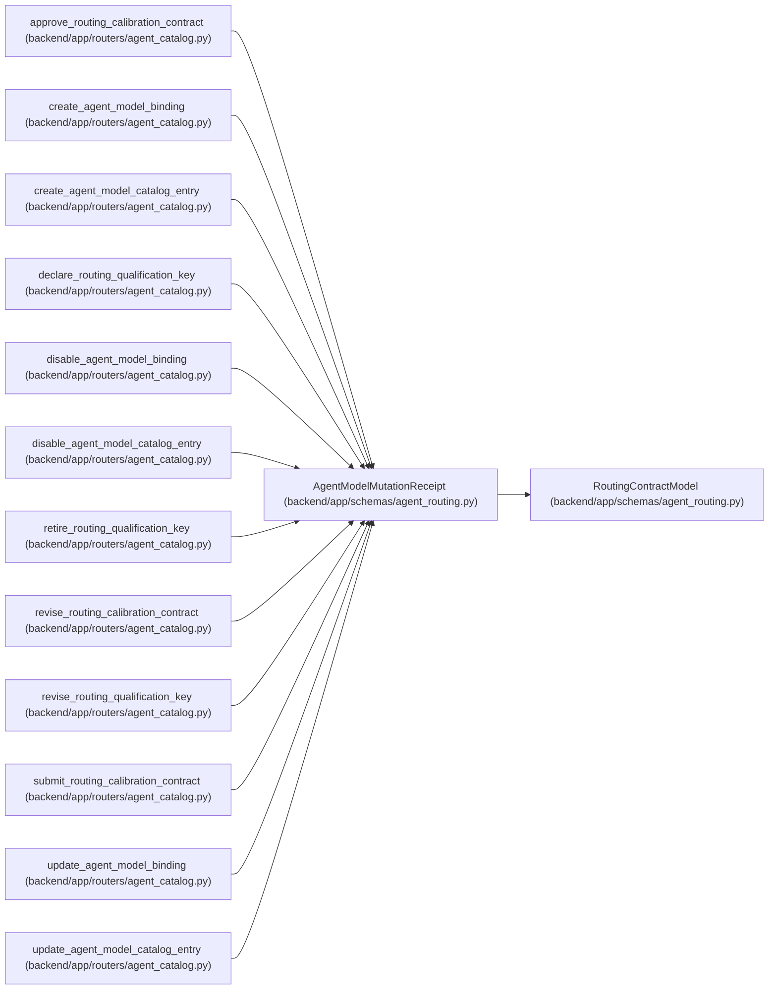

# AgentModelMutationReceipt

**Location:** `backend/app/schemas/agent_routing.py:539`
**Kind:** Pydantic model
**Bases:** `RoutingContractModel`
**Module:** [agent_routing](../modules/agent_routing.md)

## Description

Durable, replay-safe receipt for an operator model mutation.

``actor_id`` is null when the operator's admin key made the change; that
receipt is returned once and not stored for replay.

## Attributes

| Name | Type | Wire name | Required | Nullable | Default | Constraints | Examples | Description |
|------|------|-----------|----------|----------|---------|-------------|-------------|----------|
| `operation` | `str` | `operation` | Yes | No | — | max_length=100; min_length=1 | — | — |
| `actor_id` | `int \| None` | `actor_id` | Yes | Yes | — | ge=1 | — | — |
| `target_type` | `Literal['model_catalog', 'model_binding', 'routing_qualification_key', 'routing_calibration_contract']` | `target_type` | Yes | No | — | — | — | — |
| `target_id` | `int` | `target_id` | Yes | No | — | ge=1 | — | — |
| `idempotency_key` | `str` | `idempotency_key` | Yes | No | — | max_length=255; min_length=1 | — | — |
| `rationale` | `str` | `rationale` | Yes | No | — | max_length=2000; min_length=1 | — | — |
| `correlation_id` | `str` | `correlation_id` | Yes | No | — | max_length=255; min_length=1 | — | — |
| `authoritative_revision` | `PositiveRevision` | `authoritative_revision` | Yes | No | — | — | — | — |
| `invalidated_assignment_ids` | `list[int]` | `invalidated_assignment_ids` | No | No | factory: `list` | — | — | — |
| `audit_event_ids` | `list[int]` | `audit_event_ids` | No | No | factory: `list` | — | — | — |
| `result` | `dict[str, Any]` | `result` | Yes | No | — | — | — | — |

## Methods

*No declared methods.*

## Relationships

<!-- Auto-generated relationship summary. Do not edit by hand. -->

### Summary

| Module | Methods | Attributes |
|---|---:|---|
| [agent_routing](../modules/agent_routing.md) | 0 | `actor_id`, `audit_event_ids`, `authoritative_revision`, `correlation_id`, `idempotency_key`, `invalidated_assignment_ids`, `operation`, `rationale`, `result`, `target_id`, `target_type` |

### Structure

| Kind | Entity | Module |
|---|---|---|
| Base | `RoutingContractModel` | [agent_routing](../modules/agent_routing.md) |

### References

| Reference | Kind | Source | Call sites |
|---|---|---|---:|
| `approve_routing_calibration_contract` | type_reference | [agent_catalog](../modules/agent_catalog.md) | — |
| `create_agent_model_binding` | type_reference | [agent_catalog](../modules/agent_catalog.md) | — |
| `create_agent_model_catalog_entry` | type_reference | [agent_catalog](../modules/agent_catalog.md) | — |
| `declare_routing_qualification_key` | type_reference | [agent_catalog](../modules/agent_catalog.md) | — |
| `disable_agent_model_binding` | type_reference | [agent_catalog](../modules/agent_catalog.md) | — |
| `disable_agent_model_catalog_entry` | type_reference | [agent_catalog](../modules/agent_catalog.md) | — |
| `retire_routing_qualification_key` | type_reference | [agent_catalog](../modules/agent_catalog.md) | — |
| `revise_routing_calibration_contract` | type_reference | [agent_catalog](../modules/agent_catalog.md) | — |
| `revise_routing_qualification_key` | type_reference | [agent_catalog](../modules/agent_catalog.md) | — |
| `submit_routing_calibration_contract` | type_reference | [agent_catalog](../modules/agent_catalog.md) | — |
| `update_agent_model_binding` | type_reference | [agent_catalog](../modules/agent_catalog.md) | — |
| `update_agent_model_catalog_entry` | type_reference | [agent_catalog](../modules/agent_catalog.md) | — |

> References: showing 12 of 28 logical references; 16 omitted by the 12-row generated summary limit.
