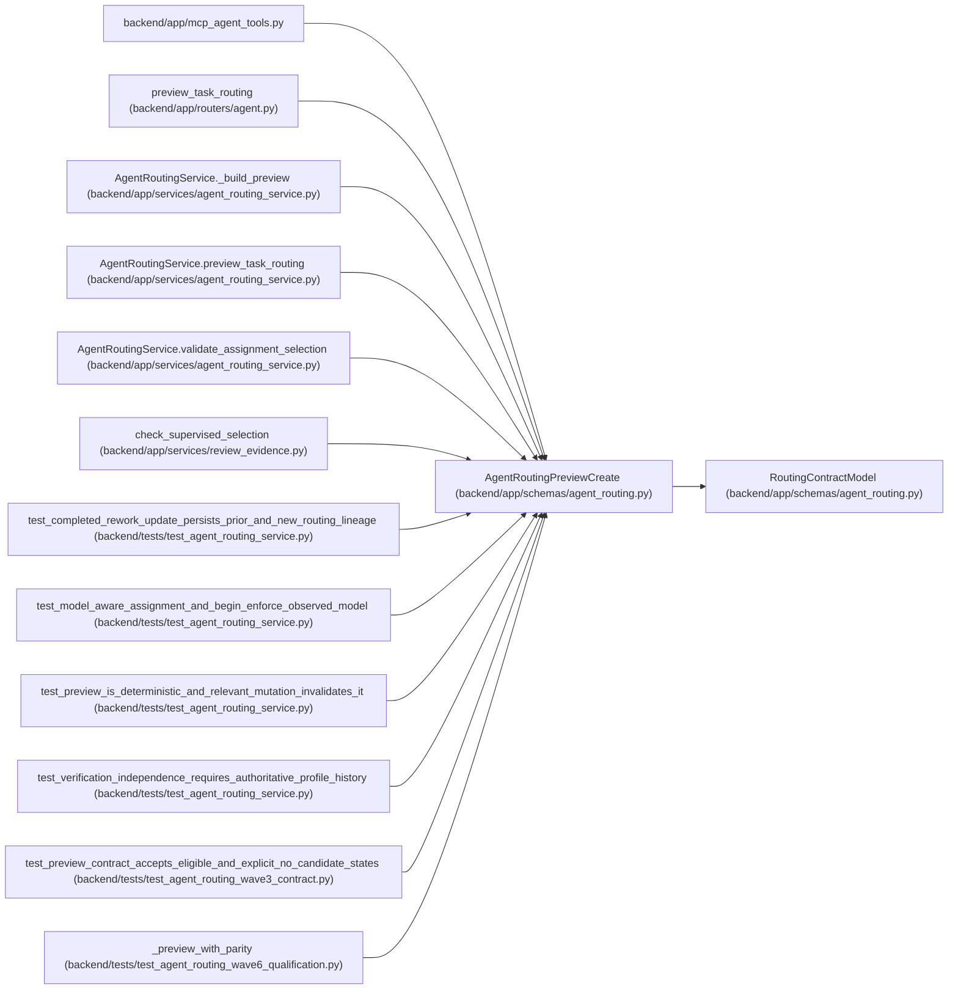

# AgentRoutingPreviewCreate

**Location:** `backend/app/schemas/agent_routing.py:925`
**Kind:** Pydantic model
**Bases:** `RoutingContractModel`
**Module:** [agent_routing](../modules/agent_routing.md)

## Description

Non-dispatching exact-actor preview bound to current task state.

## Validators

| Method | Scope | Fields | Mode | Options |
|--------|-------|--------|------|---------|
| `require_review_purpose` | model | — | after | — |

## Attributes

| Name | Type | Wire name | Required | Nullable | Default | Constraints | Examples | Description |
|------|------|-----------|----------|----------|---------|-------------|-------------|----------|
| `purpose` | `Literal['execution', 'verification']` | `purpose` | Yes | No | — | — | — | — |
| `assessment_id` | `int` | `assessment_id` | Yes | No | — | ge=1; strict=True | — | — |
| `expected_task_version` | `int` | `expected_task_version` | Yes | No | — | ge=1; strict=True | — | — |
| `reviewer_profile_id` | `int \| None` | `reviewer_profile_id` | No | Yes | `None` | ge=1; strict=True | — | — |
| `review_evidence_id` | `int \| None` | `review_evidence_id` | No | Yes | `None` | ge=1; strict=True | — | — |
| `review_assignment_id` | `int \| None` | `review_assignment_id` | No | Yes | `None` | ge=1; strict=True | — | — |
| `focus_actor_id` | `int \| None` | `focus_actor_id` | No | Yes | `None` | ge=1; strict=True | — | — |
| `focus_model_binding_id` | `int \| None` | `focus_model_binding_id` | No | Yes | `None` | ge=1; strict=True | — | — |

## Methods

| Method | Signature | Decorators | Description |
|--------|-----------|------------|-------------|
| `require_review_purpose` | `()` | `@model_validator(mode='after')` | — |

## Relationships

<!-- Auto-generated relationship summary. Do not edit by hand. -->

### Summary

| Module | Methods | Attributes |
|---|---:|---|
| [agent_routing](../modules/agent_routing.md) | 1 | `assessment_id`, `expected_task_version`, `focus_actor_id`, `focus_model_binding_id`, `purpose`, `review_assignment_id`, `review_evidence_id`, `reviewer_profile_id` |

### Structure

| Kind | Entity | Module |
|---|---|---|
| Base | `RoutingContractModel` | [agent_routing](../modules/agent_routing.md) |

### References

| Reference | Kind | Source | Call sites |
|---|---|---|---:|
| `mcp_agent_tools` | import | [mcp_agent_tools](../modules/mcp_agent_tools.md) | — |
| `preview_task_routing` | type_reference | [routers_agent](../modules/routers_agent.md) | — |
| `AgentRoutingService._build_preview` | type_reference | [agent_routing_service](../modules/agent_routing_service.md) | — |
| `AgentRoutingService.preview_task_routing` | type_reference | [agent_routing_service](../modules/agent_routing_service.md) | — |
| `AgentRoutingService.validate_assignment_selection` | call | [agent_routing_service](../modules/agent_routing_service.md) | 1 |
| `check_supervised_selection` | call | [services_review_evidence](../modules/services_review_evidence.md) | 1 |
| `test_completed_rework_update_persists_prior_and_new_routing_lineage` | call | [test_agent_routing_service](../modules/test_agent_routing_service.md) | 1 |
| `test_model_aware_assignment_and_begin_enforce_observed_model` | call | [test_agent_routing_service](../modules/test_agent_routing_service.md) | 1 |
| `test_preview_is_deterministic_and_relevant_mutation_invalidates_it` | call | [test_agent_routing_service](../modules/test_agent_routing_service.md) | 1 |
| `test_verification_independence_requires_authoritative_profile_history` | call | [test_agent_routing_service](../modules/test_agent_routing_service.md) | 1 |
| `test_preview_contract_accepts_eligible_and_explicit_no_candidate_states` | call | [test_agent_routing_wave3_contract](../modules/test_agent_routing_wave3_contract.md) | 1 |
| `_preview_with_parity` | call | [test_agent_routing_wave6_qualification](../modules/test_agent_routing_wave6_qualification.md) | 1 |

> References: showing 12 of 20 logical references; 8 omitted by the 12-row generated summary limit.
