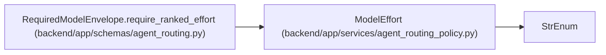

# ModelEffort

**Location:** `backend/app/services/agent_routing_policy.py:118`
**Kind:** Enum
**Bases:** `StrEnum`
**Module:** [agent_routing_policy](../modules/agent_routing_policy.md)

## Description

Reasoning-effort setting a catalog entry runs at.

``unknown`` is the explicit value for an entry whose setting is not
recorded; it is not ordered and can never satisfy a stated requirement.

## Attributes

| Name | Declared value | Description |
|------|-------|-------------|
| `UNKNOWN` | `'unknown'` | — |
| `LOW` | `'low'` | — |
| `MEDIUM` | `'medium'` | — |
| `HIGH` | `'high'` | — |
| `XHIGH` | `'xhigh'` | — |
| `MAX` | `'max'` | — |

## Methods

*No declared methods.*

## Relationships

<!-- Auto-generated relationship summary. Do not edit by hand. -->

### Summary

| Module | Methods | Attributes |
|---|---:|---|
| [agent_routing_policy](../modules/agent_routing_policy.md) | 0 | `HIGH`, `LOW`, `MAX`, `MEDIUM`, `UNKNOWN`, `XHIGH` |

### Structure

| Kind | Entity | Module |
|---|---|---|
| Base | `StrEnum` | — |

### References

| Reference | Kind | Source | Call sites |
|---|---|---|---:|
| `RequiredModelEnvelope.require_ranked_effort` | type_reference | [agent_routing](../modules/agent_routing.md) | — |
