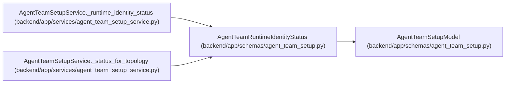

# AgentTeamRuntimeIdentityStatus

**Location:** `backend/app/schemas/agent_team_setup.py:1004`
**Kind:** Class
**Bases:** `AgentTeamSetupModel`
**Module:** [agent_team_setup](../modules/agent_team_setup.md)

## Description

Which runtime instance acknowledged a member's handoff, and any change or refusal of it.

``unknown`` is a member that has not acknowledged, or acknowledged without
an identity, as every acknowledgement did before the identity existed.
``current`` returned the identity the handoff carries now; ``changed`` did
so after another identity (``previous_instance_id``) held the seat, and
``stale`` returned an earlier identity than the handoff carries now, as
after a recovered credential. A runtime that returned an identity other
than the issued one and was turned away is shown by ``refused_*``, beside
whichever state the acknowledgement gives, until a matching acknowledgement
clears it.

## Attributes

| Name | Type | Default | Description |
|------|------|---------|-------------|
| `state` | `Literal['unknown', 'current', 'changed', 'stale']` | `'unknown'` | — |
| `expected_instance_id` | `str \| None` | `None` | — |
| `acknowledged_instance_id` | `str \| None` | `None` | — |
| `previous_instance_id` | `str \| None` | `None` | — |
| `changed_at` | `datetime \| None` | `None` | — |
| `refused_instance_id` | `str \| None` | `None` | — |
| `refused_at` | `datetime \| None` | `None` | — |

## Methods

*No declared methods.*

## Relationships

<!-- Auto-generated relationship summary. Do not edit by hand. -->

### Summary

| Module | Methods | Attributes |
|---|---:|---|
| [agent_team_setup](../modules/agent_team_setup.md) | 0 | `acknowledged_instance_id`, `changed_at`, `expected_instance_id`, `previous_instance_id`, `refused_at`, `refused_instance_id`, `state` |

### Structure

| Kind | Entity | Module |
|---|---|---|
| Base | `AgentTeamSetupModel` | [agent_team_setup](../modules/agent_team_setup.md) |

### References

| Reference | Kind | Source | Call sites |
|---|---|---|---:|
| `AgentTeamSetupService._runtime_identity_status` | call | [agent_team_setup_service](../modules/agent_team_setup_service.md) | 1 |
| `AgentTeamSetupService._runtime_identity_status` | type_reference | [agent_team_setup_service](../modules/agent_team_setup_service.md) | — |
| `AgentTeamSetupService._status_for_topology` | call | [agent_team_setup_service](../modules/agent_team_setup_service.md) | 1 |
